[English](README.md) · [한국어](README.ko.md) · **Español** · [中文](README.zh-CN.md) · [日本語](README.ja.md)

<a href="https://youtu.be/gw3gqoHlFvA">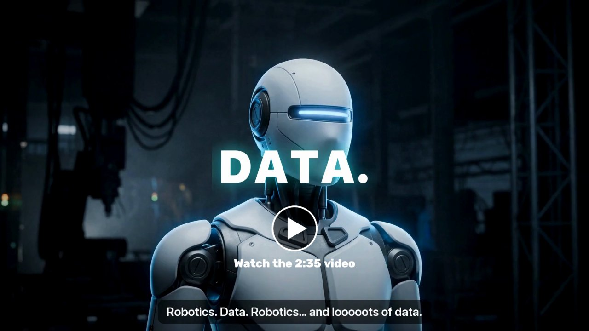</a> <a href="https://youtu.be/o1sGUME0GHw">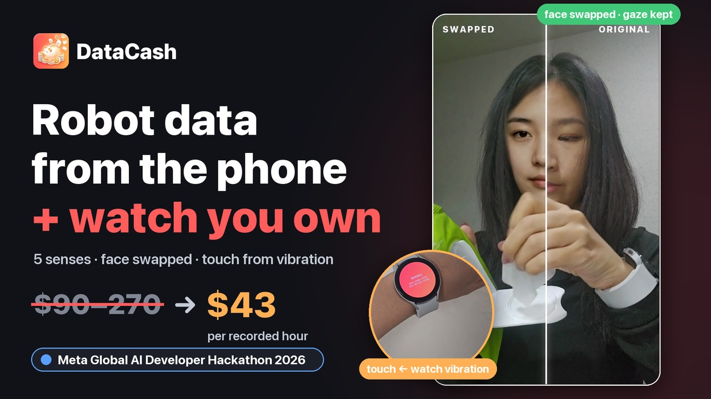</a>

[Video (2:35)](https://youtu.be/gw3gqoHlFvA) · Demo de 3 minutos: [English](https://youtu.be/o1sGUME0GHw) · [한국어](https://youtu.be/DEu_gY3T2vE)

# DataCash

**Datos de manos humanas para robots, grabados por personas comunes con el teléfono y el reloj que ya tienen.**

Las personas graban en casa misiones cortas de habilidades para robots (sacar un pañuelo, mover una taza, girar una tapa — 12 en total) con su teléfono y su reloj inteligente, y reciben un pago.
Las empresas de humanoides e IA física compran el resultado: datos de **cinco sentidos — vista, oído, tacto (fuerza de agarre), movimiento y fisiología (frecuencia cardíaca)** sin datos personales, sincronizados en un mismo reloj
y entregados como un conjunto de datos **LeRobot v3.0** listo para entrenar.

Proyecto para el Meta Global AI Developer Hackathon (Indie Developer · Push the Frontier).


## En resumen

| | |
|---|---|
| Participantes | App de Android + app de reloj. Elige una misión → verificación facial → graba → 1–2 preguntas → *ding*, recibes tu pago |
| Compradores | **Piden en lenguaje natural** desde la web ("datos de levantar cajas para robots de almacén, 20–50 años, presupuesto 3.000 USD") → la IA diseña las misiones y las abre en todo el mundo |
| Privacidad | El rostro del participante se reemplaza por **una persona que no existe**; se ocultan transeúntes, pantallas y documentos; los originales se borran tras el procesamiento |
| Tacto | Sin guante — **el reloj vibra y mide cuánto absorbe la mano** para estimar la fuerza de agarre (GripSense, UIST 2012) |

## Dónde se usan los modelos de Meta

| Modelo | Función | Código |
|---|---|---|
| **SAM 3.1** | Oculta personas sin consentimiento, niños, pantallas, espejos, cuadros y documentos (seguimiento en video); segmenta el objeto manipulado → `observation.objects` | `datacash/meta/sam.py`, `datacash/privacy/mask.py` |
| **Muse Spark 1.3** | Video ocultado → pasos, instrucciones, mano activa, objetos, errores (JSON estructurado); petición en lenguaje natural → diseño de misiones | `datacash/understand/`, `datacash/requests.py` |
| **Muse Image** | 34 personas que no existen (7 regiones × mujeres/hombres × 20–60 años) para reemplazar rostros, más 24 fotos en ángulo de cada una (edición, `images.edit`) | `scripts/make_donors.py`, `scripts/make_donor_views.py`, `datacash/donors/` |
| **Muse Voice Transcribe** | Detecta información personal hablada en la grabación y la silencia | `datacash/privacy/speech.py` |
| **Muse Spark Open** (pesos abiertos, 816B) | Segunda opinión sobre cada grabación y revisor de apelaciones (Baseten, con Fireworks de respaldo). Si los dos modelos difieren, corrige el paso; los pasos en que coinciden y que los sensores verifican se vuelven ejemplos que se añaden a las siguientes consultas de Spark 1.3 — las etiquetas mejoran con el uso sin cambiar pesos | `datacash/understand/spark_open.py`, `datacash/evolve.py` ([docs/model_evolution.md](docs/model_evolution.md)) |

Cada llamada a la API se registra con su costo en `data/api_ledger.jsonl`; si se alcanza el presupuesto, solo se omite ese paso.

## Rendimiento medido

Cada número se mide contra **etiquetas humanas** o una referencia física y se reproduce sin llamadas a la API: `python scripts/perf_report.py` (escribe `docs/perf/`). La página de operador tiene una pestaña **Performance** con los mismos gráficos y monitorización en vivo con alertas.

| Qué | Antes → ahora | Medido en |
|---|---|---|
| Precisión por fotograma de etiquetas (Muse Spark 1.3) | **35,6% → 54,3%** | EPIC-KITCHENS-100, 8 clips reservados, 271 pasos humanos |
| Error de límite (mediana) | **430 → 182 ms** | igual |
| Muse Glimmer 30B (LoRA, Fireworks) | **41,8% → 54,1% → 64,1%** (v80, entrenado con etiquetas humanas; v82 + decodificación del orden por misión, rango 60,7–67,2%) | 122 pasos humanos, 8 grabaciones reservadas |
| Sincronización reloj ↔ vídeo | **24,7 → 3,7 ms** (objetivo < 10 ms) | 37 grabaciones |
| Cambio de cara por grabación | **636 → 84 s** (7,5×) | `docs/privacy_eval.md` |
| Coste SAM 3.1, 4 grabaciones | **$2,92 → $0,27** (−91%) | 4 grabaciones reales |

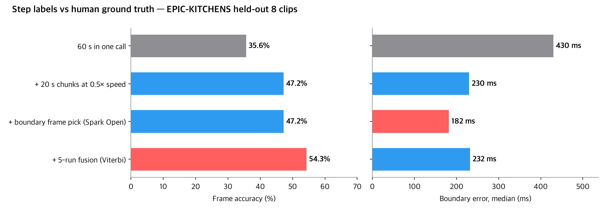
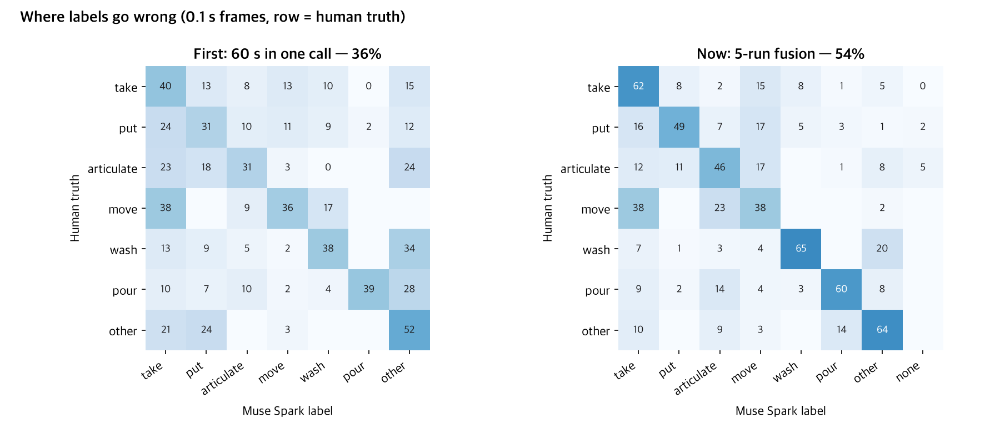
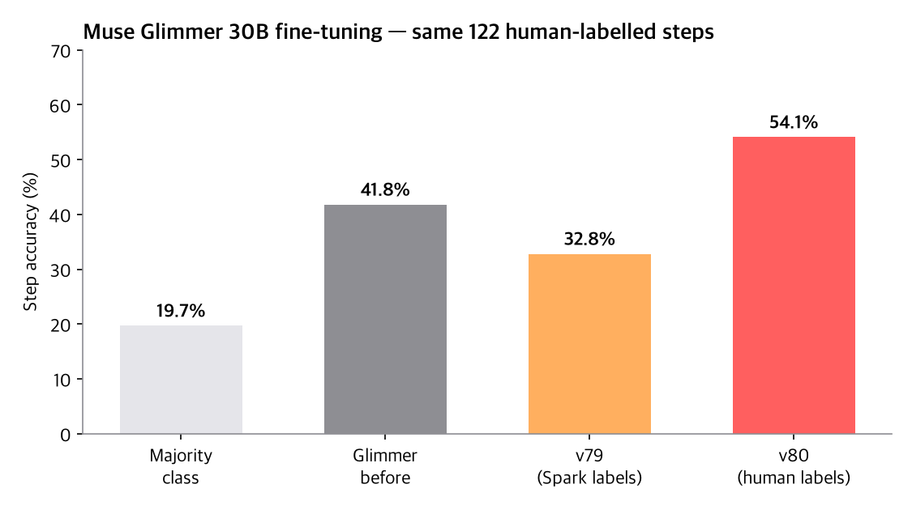
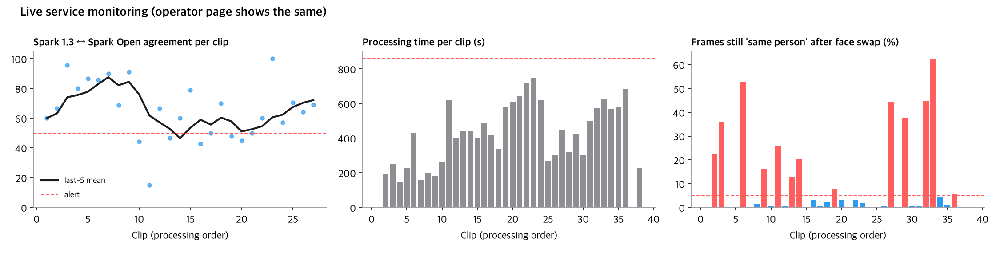

## Ideas clave

### 1. Privacidad que conserva el valor de los datos
- **Reemplazo de rostro, no desenfoque:** el rostro del participante se cambia por una persona de Muse Image (LivePortrait + MediaPipe). Elegimos a la más parecida del mismo género y edad similar, probamos 20 fotogramas y pasamos a la siguiente si el reconocimiento facial (SFace) consideraría "la misma persona" a más de la mitad.
- **Continuidad:** si un fotograma reemplazado sale demasiado parecido, se regenera con una expresión más suave en lugar de pixelarlo — el video nunca se corta.
- **Ocultación:** SAM 3.1 oculta solo lo que no tiene consentimiento: otras personas, niños, pantallas, espejos, cuadros y documentos. Los familiares que consienten siguen visibles, cada uno con su propio rostro virtual.
- **Originales borrados:** en producción, el video y el audio originales se borran al terminar el procesamiento (`purge_originals`). En el servidor de demostración del hackathon solo esa llamada está desactivada, para poder mostrar la comparación original vs. reemplazado.

#### Cómo evolucionó la sustitución de caras
Números completos y lo que probamos y descartamos: [`docs/privacy_eval.md`](docs/privacy_eval.md) (en coreano).

| Fecha | Cambio | Resultado |
|---|---|---|
| 10-27 | Sustituir por una persona sintética en vez de difuminar (LivePortrait), comprobación de reidentificación en cada fotograma | La cara queda, la persona cambia |
| 10-27 | Caras pequeñas y lejanas: YuNet, ampliar la zona y 478 puntos | Vídeo público, 192 fotogramas: sustituidas 106 → 183, pixeladas 86 → 4 |
| 10-27 | Velocidad: el Conv3d lento en la GPU del Mac dividido en 7 convoluciones 2D + fp16 | Una grabación 636 → 84 s |
| 10-27 | 34 personas sintéticas; si se reidentifica, se regenera con menos expresión en vez de pixelar | 3 de 387 fotogramas pixelados |
| 10-29 | Perfiles: se dejan si no son reconocibles; si lo son, se sustituyen alineados a 5 puntos | 26 grabaciones: sustituido 81,6 % · difuminado 0,5 % |
| 11-01 | Medir cortes (sustituida ↔ original ↔ difuminada); seguir la cara en fotogramas perdidos y desvanecer | 4 grabaciones: cortes 181 → 149 |
| 11-01 | Máscara 3D tipo filtro → descartada por poco natural. Expresión y mirada se guardan aparte desde el original | `observation.face`, 60 valores |
| 11-01 noche | 24 fotos en ángulo de la misma persona sintética (edición de Muse Image) → la foto más cercana al ángulo del fotograma es la fuente | Cabezas inclinadas y perfiles menos deformados (figura) |
| 11-01 noche | Puños detectados como cara se filtran por distancia a la cara del participante | Recuento de cortes honesto (taza 87 → 55) |
| 11-01 noche | Probado y descartado: modelo propio de intercambio de caras, dejar el pelo sobre la cara, sustituir también perfiles no reconocibles | Mancha borrosa · ojos originales visibles · 40 % raros |
| 11-01 noche | Reidentificación más estricta (contra 20 fotos frontales del participante) | 3–31 % de los fotogramas sustituidos aún coinciden (fotos de otras personas: 2,7 %) — ligado a elegir la persona sintética más parecida; opciones en el documento |
| 11-01 | Nueva elección de la persona sintética: mismo género · edad · grupo (deducido de la foto más parecida); se prueba cada candidata sustituyendo fotogramas y se elige la que queda menos parecida al participante (+24 personas sintéticas de Asia oriental, 20–50 años, 6 $) | Fotogramas reconocidos 3,3 / 11,1 / 17,3 / 30,9 % → 2,9 / 9,3 / 10,4 / 6,4 %. Solo la *foto* menos parecida fue peor (26,8 %); ignorar el grupo ponía caras negras/blancas a participantes de Asia oriental |
| 11-01 | Se sustituían caras pequeñas detectadas en un puño que sujeta una taza (aparecía una cara en la mano) → las caras pequeñas lejos de una cara confirmada solo se sustituyen si se reconocen | Grabación de la taza 221 → 167 fotogramas sustituidos: los 54 eliminados eran el puño |
| 11-01 | 8 mujeres sintéticas más de Asia oriental de 20 años con rasgos muy distintos (y 4 hombres, 3 $) + fotogramas de prueba 30 → 90 (con 30, un fotograma invertía el orden). Sin más difuminado | Fotogramas reconocidos 2,9 / 9,3 / 10,4 / 6,4 % → 2,4 / 6,4 / 1,7 / 5,0 %; casi la mitad menos de expresión atenuada (figura) |

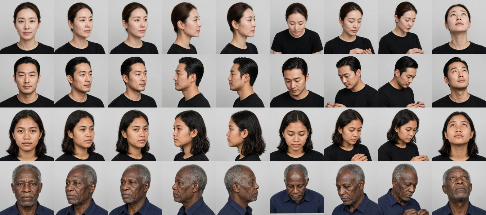
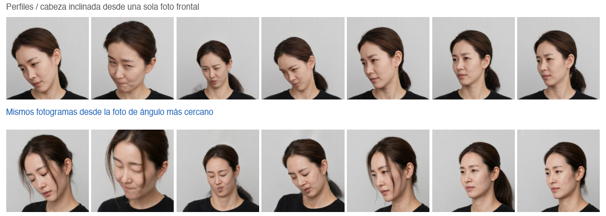
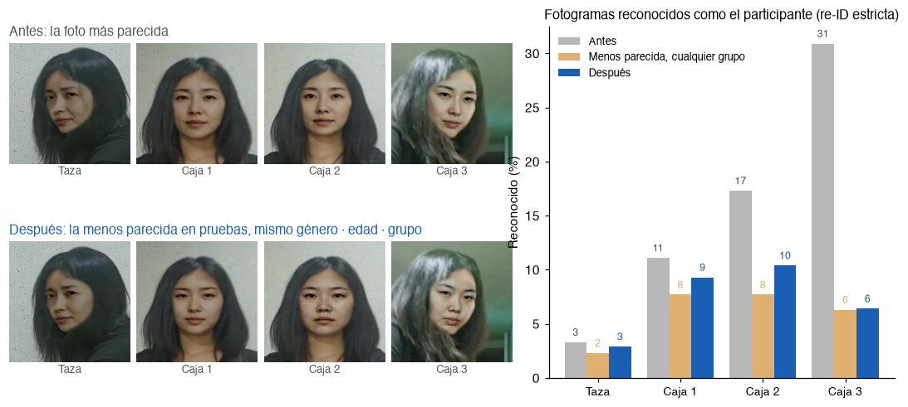

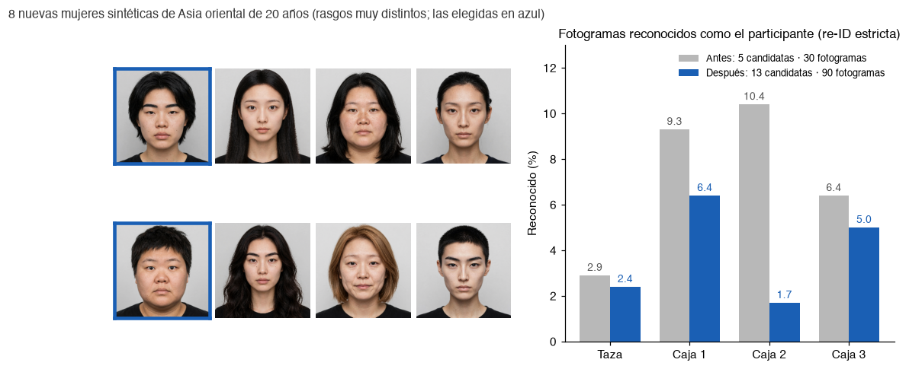

### 2. Cinco sentidos, sincronizados automáticamente
Sin aplaudir: ida y vuelta del reloj teléfono↔reloj, una baliza acústica de 18–20 kHz y pulsos de vibración del reloj. En 37 grabaciones reales con teléfono + reloj, la baliza acústica alinea 24 (residuo por par 0,1–1,9 ms); el resto usa el reloj vía servidor, que se desvía 24,7 ms (±3,5) de la baliza, así que ese sesgo se mide por par de dispositivos y se resta (máx. 9,2 ms dejando una fuera). Mediciones en `docs/sync_eval.md`, código en `datacash/sync/`.


### 3. Tacto sin guante — GripSense en la muñeca
Trasladamos *GripSense* de Goel, Wobbrock y Patel (UIST 2012) a la muñeca. El reloj vibra brevemente; cuanto más fuerte agarras, más vibración absorbe la mano — baja la energía de alta frecuencia del giroscopio y sube el temblor de 4–12 Hz de los dedos. Un árbol de decisión por persona, entrenado con niveles autoevaluados (soltar · suave · normal · fuerte, sin báscula), da el nivel de agarre 0–3 (`datacash/touch/`). Medido en un Galaxy Watch4 (IMU limitado a 100 Hz, 3 grabaciones de calibración, entrenar en la ronda 1 → probar en la 2 y al revés): un bosque de 25 árboles con suavizado de 2 s llega al 59% en 4 niveles (azar 25%, fuerte 93%); mientras el vídeo ve la mano tocando un objeto, un bosque de regresión de 50 árboles da el agarre como puntuación 0–100 (p. ej. «medio (57)»); cortado en bajo · medio · alto acierta el 83%, error medio de 15 puntos.
La frecuencia cardíaca, los intervalos entre latidos y la temperatura de la piel vienen del Samsung Health Sensor SDK (`docs/samsung_health_sdk.md`).

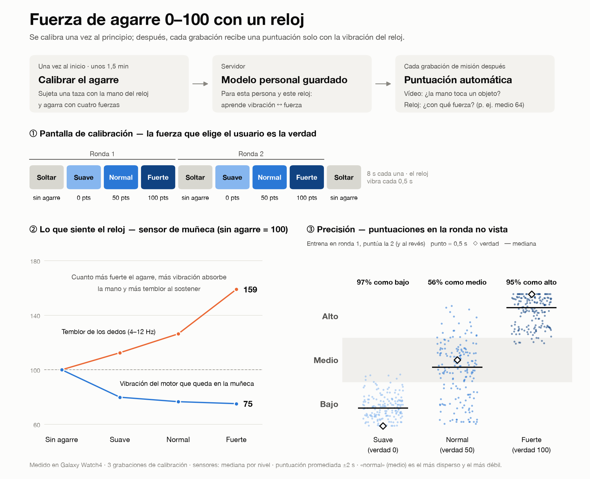

### 4. Peticiones en lenguaje natural → misiones
El comprador escribe lo que necesita; Muse Spark (salida estructurada) diseña las misiones (acciones, objetos, condiciones a variar), los requisitos (edad, género) y los paquetes de sensores, y el servidor ajusta un presupuesto. Al confirmarse, las misiones solo aparecen para los participantes que cumplen los requisitos — la petición *es* la distribución de la recolección.

### 5. Costos de procesamiento que dejan margen
- Las grabaciones inútiles (muy cortas, manos no visibles, muy oscuras) se rechazan **en local antes de cualquier llamada a la API** — 0 USD
- Un detector de objetos local revisa primero; SAM solo recibe lo necesario (sin consulta "person" en grabaciones individuales, pantallas solo si aparecen, objetos estáticos a 1 fps)
- En 4 grabaciones reales: costo de SAM **2,92 → 0,27 USD (−91 %)**, unos 5–7 USD por hora de video (se vende a ~43 USD/hora)
- Decodificación de máscaras de SAM reescrita con Numba: 593 s → 8 s por grabación, idéntica bit a bit al analizador oficial

## El conjunto de datos (LeRobot v3.0)

`observation.images.ego` (video ocultado + rostro reemplazado) · `observation.hands` · `observation.body` · `observation.face` · `observation.imu.phone` · `observation.imu.wrist` ·
`observation.audio` · **`observation.touch`** (contacto, agarre bajo · medio · alto + puntuación 0–100) · `observation.touch.vibration` · **`observation.physio`** (frecuencia cardíaca, temperatura de la piel; solo con consentimiento biométrico) ·
`observation.objects` · `annotation.step` · `annotation.primitive` (reach · grasp · … · release) · `sync.error_ms` + un certificado de calidad.
Se carga con `lerobot` 0.6.1 real (`scripts/validate_lerobot.py`).

Los compradores eligen paquetes de sensores por hora de datos — video (obligatorio) ₩35.000 · pose ₩20.000 · audio ₩5.000 · IMU de muñeca ₩15.000 · tacto ₩25.000 · biometría ₩50.000 (`datacash/pricing.py`).

## Arquitectura

**Flujo general** — la empresa pide en palabras, se abren misiones, los participantes graban con teléfono y reloj, el servidor procesa, entrega el dataset y paga la recompensa.

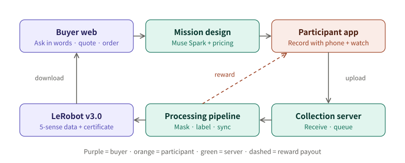

**Cómo se procesa una grabación** (`datacash/jobs.py`) — primero los pasos locales sin coste, así las grabaciones inservibles se rechazan antes de llamar a un modelo de Meta.

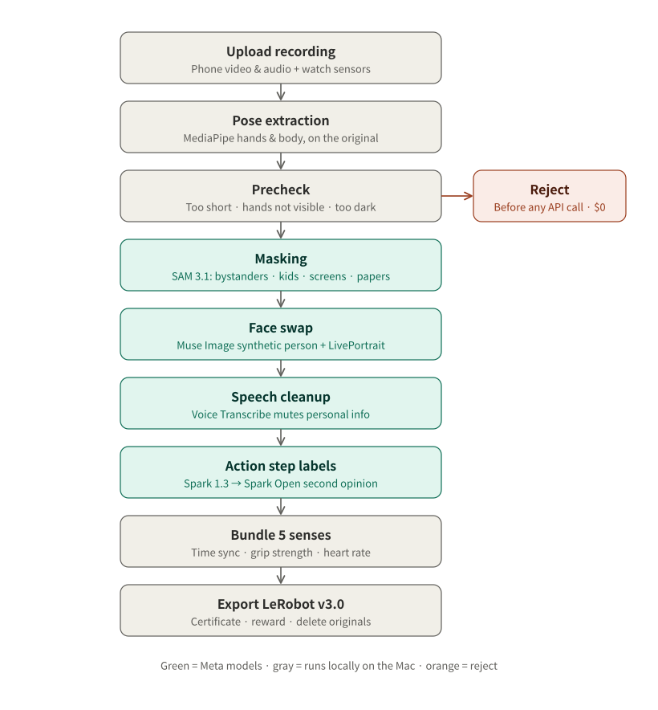

**Tecnologías y despliegue** — hoy no hay Docker ni nube: un solo Mac ejecuta el servidor y todo el procesamiento, y las apps del teléfono y del reloj lo encuentran por mDNS en la misma Wi-Fi.

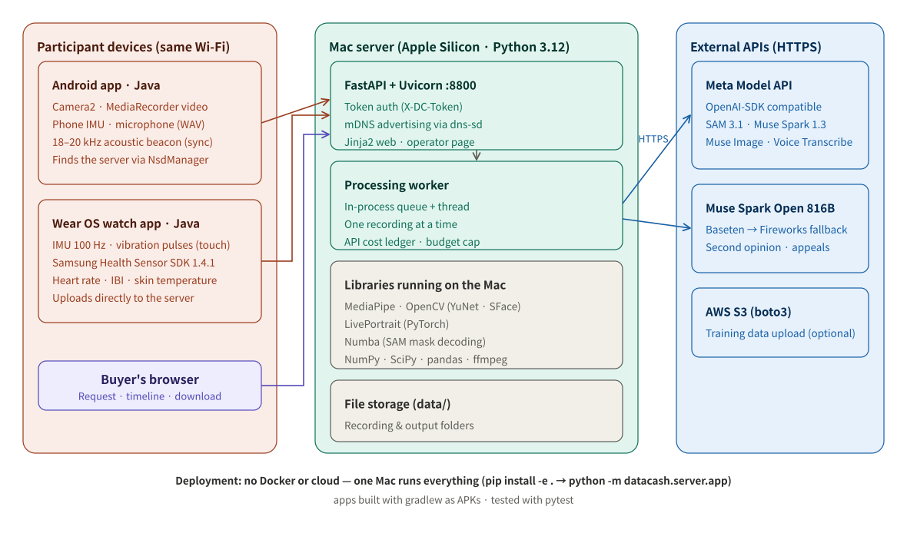

## Ejecutar

```bash
python3.12 -m venv .venv && .venv/bin/pip install -e ".[dev]" torch pyyaml rich
echo "MODEL_API_KEY=..." > .env                       # nunca se sube al repositorio
# data/models: MediaPipe hand/pose/face landmarker .task, efficientdet_lite0.tflite, OpenCV yunet.onnx + sface.onnx
.venv/bin/python -m pytest                            # verificado con sesiones sintéticas de resultado conocido
DATACASH_TOKEN=... .venv/bin/python -m datacash.server.app --port 8800   # servidor + web para compradores
cd app && ./gradlew assembleDebug                     # app de Android + app de reloj
```

LivePortrait no se incluye — descarga [KwaiVGI/LivePortrait](https://github.com/KwaiVGI/LivePortrait) (MIT) y apunta `LP_ROOT` a esa carpeta.

## Estructura

| Carpeta | Qué hace |
|---|---|
| `app/` | App de Android (consentimiento, misiones, verificación facial, grabación, marcar errores, preguntas, subida, pagos, apelaciones) + app de reloj |
| `web/` | Web para compradores (peticiones en lenguaje natural, línea de tiempo de cinco sentidos, presupuestos, pedidos, descargas) y consola del operador |
| `datacash/privacy` | Ocultación con SAM · reemplazo de rostro · privacidad del habla · revisión previa |
| `datacash/sync` · `touch` · `labels` | Sincronización · tacto · pose de manos y cuerpo |
| `datacash/understand` | Comprensión con Muse Spark · segunda opinión con Spark Open · verificación con sensores |
| `datacash/export` · `jobs.py` | Exportación LeRobot · certificado · flujo de procesamiento |
| `datacash/server` | Servidor de recolección + API para compradores |

## Documentos (en coreano)

- Plan del hackathon: [docs/1026_meta_hackathon.md](docs/1026_meta_hackathon.md) · Registro del día 1: [docs/DAY1.md](docs/DAY1.md)
- Evaluación de ocultación y reemplazo de rostro: [docs/privacy_eval.md](docs/privacy_eval.md) · Verificación de modelos de Meta: [docs/model_check.md](docs/model_check.md)
- SDK del reloj: [docs/samsung_health_sdk.md](docs/samsung_health_sdk.md) · Guion del video demo: [docs/demo_video_script.md](docs/demo_video_script.md)

## Antes y durante el hackathon

| | Contenido |
|---|---|
| Antes (hasta el 26 de octubre) | Solo el documento de planificación y la imagen de marca. Sin código |
| Durante (desde el 27 de octubre, 01:00 KST) | Todo el código, la app, la web, las personas de Muse Image y los documentos de este repositorio |

## Licencias y fuentes

MediaPipe (Apache 2.0) · OpenCV YuNet y SFace (Apache 2.0) · LivePortrait (MIT) · LeRobot (Apache 2.0) · Numba (BSD).
Los videos de prueba son de Wikimedia Commons (solo CC BY, CC BY-SA o dominio público; fuentes en `docs/privacy_eval.md`) y no se suben al repositorio.
El Samsung Health Sensor SDK no se sube al repositorio, según sus términos.
