[English](README.md) · [한국어](README.ko.md) · [Español](README.es.md) · [中文](README.zh-CN.md) · **日本語**

<a href="https://youtu.be/gw3gqoHlFvA">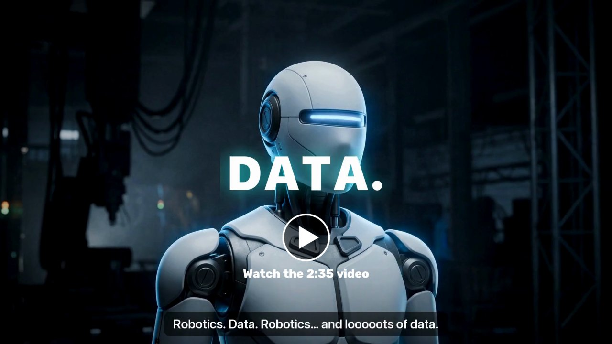</a> <a href="https://youtu.be/o1sGUME0GHw">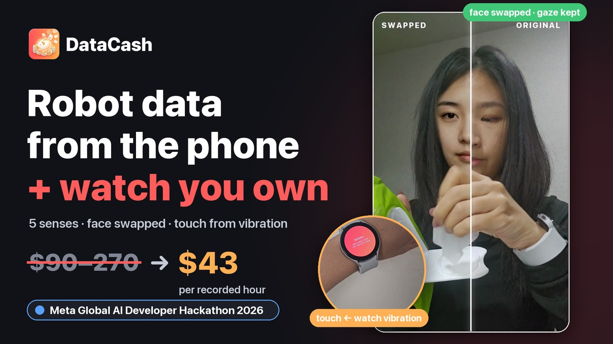</a>

[紹介動画 (2:35)](https://youtu.be/gw3gqoHlFvA) · 3 分デモ: [English](https://youtu.be/o1sGUME0GHw) · [한국어](https://youtu.be/vClUIqrZjBY)

# DataCash

**みんながすでに持っているスマホとスマートウォッチだけで、ロボットが学ぶ人の手のデータを集める。**

人々は自宅で、ロボットの基本動作ミッション（ティッシュを引き出す・コップを移す・ふたを回すなど全 12 種類）をスマホとスマートウォッチで撮影し、報酬を受け取ります。
ヒューマノイドやフィジカル AI の企業が購入するのは、個人情報を取り除いた **5感のデータ —— 視覚・聴覚・触覚（握る力）・動き・生体（心拍）** を一つの時間軸にそろえ、
そのまま学習に使える **LeRobot v3.0** 形式のデータセットです。

Meta Global AI Developer Hackathon（Indie Developer · Push the Frontier）出品作。


## ひと目で

| | |
|---|---|
| 撮影する人 | Android アプリ + ウォッチアプリ。ミッションを選ぶ → 顔の確認 → 撮影 → 質問に 1〜2 個答える → 「チャリン」と報酬 |
| 購入する企業 | Web で**ふつうの言葉で依頼**（「倉庫ロボット用の箱を持ち上げるデータ、20〜50 代、予算 3,000 ドル」）→ AI がミッションを設計して世界中に公開 |
| プライバシー | 参加者の顔は**実在しない人**に置き換え、同意していない人・画面・書類は隠し、処理が終わったら元の映像は削除 |
| 触覚 | 手袋なしで —— **ウォッチが自ら振動し、手がその振動をどれだけ吸収するか**で握る力を推定（GripSense、UIST 2012） |

## Meta のモデルをどこに使っているか

| モデル | 役割 | コード |
|---|---|---|
| **SAM 3.1** | 同意していない人・子ども・画面・鏡・写真立て・書類を隠す（動画追跡）、扱っている物体の領域 → `observation.objects` | `datacash/meta/sam.py`、`datacash/privacy/mask.py` |
| **Muse Spark 1.3** | 隠した映像 → 手順・指示文・使う手・物体・ミス（構造化 JSON）、企業のふつうの言葉の依頼 → ミッション設計 | `datacash/understand/`、`datacash/requests.py` |
| **Muse Image** | 実在しない 34 人（7 地域 × 男女 × 20〜60 代）—— 顔の置き換え用、各人の角度写真 24 枚（編集 `images.edit`） | `scripts/make_donors.py`、`scripts/make_donor_views.py`、`datacash/donors/` |
| **Muse Voice Transcribe** | 録音の中で話された個人情報を見つけて消音 | `datacash/privacy/speech.py` |
| **Muse Spark Open**（オープンウェイト、816B） | すべての録画のセカンドオピニオンと、異議申し立てを見直す「より高いモデル」（Baseten、だめなら Fireworks）。2 つのモデルの見方が違う手順は直し、一致してセンサーでも確かめた手順は正解例として次の録画の Spark 1.3 への質問に付く —— 重みを変えずに使うほど正確になる | `datacash/understand/spark_open.py`、`datacash/evolve.py`（[docs/model_evolution.md](docs/model_evolution.md)） |

API を呼ぶたびに費用を `data/api_ledger.jsonl` に記録し、上限を超えたらその段階だけをスキップします。

## 測定した性能

以下の数値はすべて**人手の正解ラベル**または物理的な基準と比較したもので、API を呼ばずに再現できます：`python scripts/perf_report.py`（`docs/perf/` に出力）。運営者画面の **Performance** タブに同じグラフと、処理された録画ごとのリアルタイム監視・アラートがあります。

| 項目 | 以前 → 現在 | 測定対象 |
|---|---|---|
| ステップラベルのフレーム精度（Muse Spark 1.3） | **35.6% → 54.3%** | EPIC-KITCHENS-100 未使用 8 区間、人手 271 ステップ |
| ステップ境界誤差（中央値） | **430 → 182 ms** | 同上 |
| Muse Glimmer 30B（LoRA、Fireworks） | **41.8% → 54.1% → 64.1%**（v80 は人手ラベルで学習、v82 + ミッションごとの順序デコード、範囲 60.7–67.2%） | 未使用録画 8 本の人手 122 ステップ |
| ウォッチ ↔ 映像の同期誤差 | **24.7 → 3.7 ms**（目標 < 10 ms） | 録画 37 本 |
| 録画 1 本の顔置換時間 | **636 → 84 秒**（7.5 倍） | `docs/privacy_eval.md` |
| SAM 3.1 コスト、録画 4 本 | **$2.92 → $0.27**（−91%） | 実録画 4 本 |

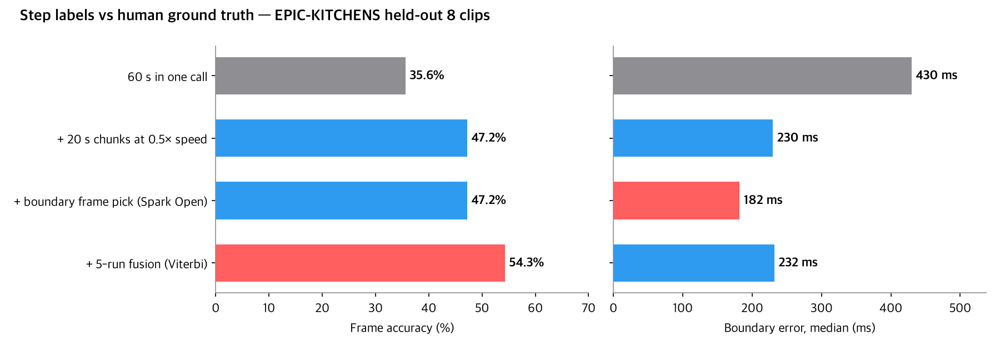
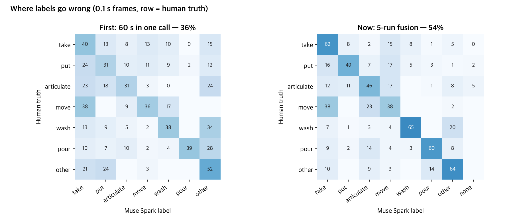
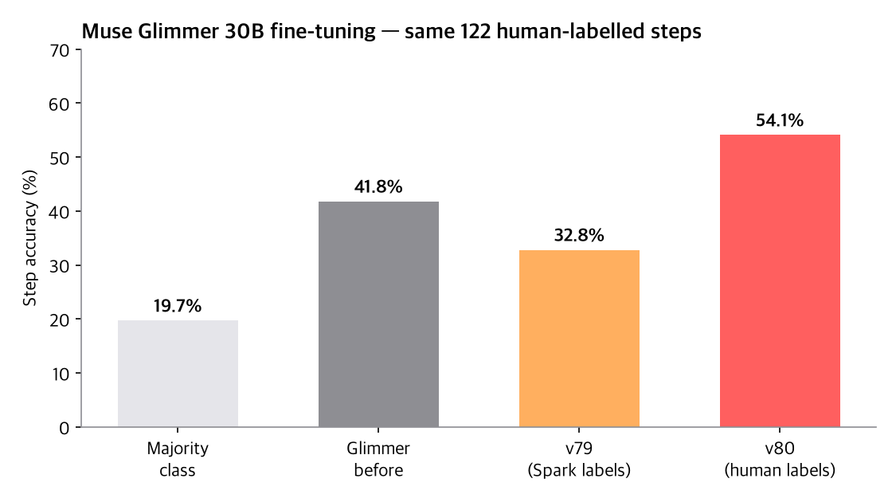
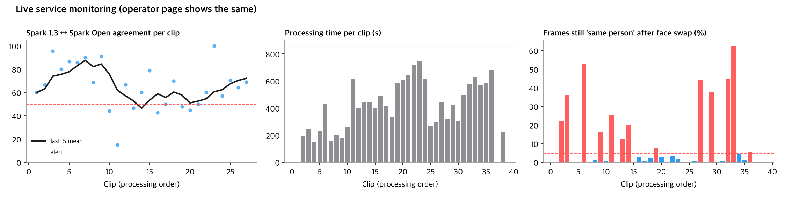

## 主な技術

### 1. データの価値を守るプライバシー処理
- **ぼかしではなく顔の置き換え：** 参加者の顔を Muse Image で作った人物に置き換えます（LivePortrait + MediaPipe）。同じ性別・近い年齢の中でいちばん似た人を選び、20 フレームを試しに置き換え、顔認識（SFace）が半分以上を「同じ人」と判断するなら次の人へ。
- **連続性：** 置き換えた顔が似すぎたフレームは、モザイクではなく表情を弱めて作り直します —— 映像が途切れません。
- **隠す：** SAM 3.1 で同意のないものだけ —— ほかの人・子ども・画面・鏡・写真立て・書類。同意した家族は隠さず、一人ひとり別の仮想の顔に。
- **元データの削除：** サービスでは処理が終わるとすぐに元の映像・音を削除します（`purge_originals`）。ハッカソンのデモ用サーバーでは、元の映像と置き換え後の比較を見せるため、この呼び出しだけを止めています。

#### 顔置き換えの改良の歩み
詳しい数値と試してやめた方法は [`docs/privacy_eval.md`](docs/privacy_eval.md)（韓国語）。

| 日付 | 変更 | 結果 |
|---|---|---|
| 10-27 | ぼかしの代わりに仮想人物へ置き換え (LivePortrait)、毎フレーム再識別チェック | 顔は残り、人は変わる |
| 10-27 | 小さく遠い顔: YuNet で見つけ、周囲を拡大して顔の点 478 個 | 公開動画 192 フレーム: 置き換え 106 → 183、モザイク 86 → 4 |
| 10-27 | 速度: Mac GPU で遅い Conv3d を 2D 7 回に分割 + fp16 | 録画 1 本 636 → 84 秒 |
| 10-27 | 仮想人物 34 人。再識別されたらモザイクではなく表情を弱めて作り直す | 387 フレーム中モザイク 3 |
| 10-29 | 横顔: 識別できなければそのまま、識別できれば 5 点に合わせて置き換え | 26 本: 置き換え 81.6% · ぼかし 0.5% |
| 11-01 | 途切れ（置き換え ↔ 元 ↔ ぼかし）を測り、見失ったフレームは追従しながら徐々に消す | 4 本: 途切れ 181 → 149 |
| 11-01 | フィルター風 3D マスク → 不自然で不採用。表情・視線の値は元映像から別に保存 | `observation.face` 60 値 |
| 11-01 夜 | 同じ仮想人物の角度写真 24 枚（Muse Image 編集）→ 場面の角度に最も近い写真を元に | うつむき・横顔の歪みが減少（下図） |
| 11-01 夜 | 拳を顔と誤検出した場面を参加者の顔の近くかどうかで除外 | 途切れ数が正確に（カップ録画 87 → 55） |
| 11-01 夜 | 試して不採用: 自前学習の顔交換モデル、髪を顔の上に残す、識別できない横顔まで置き換え | ぼやけた塊 · 元の目が残る · 40% が不自然 |
| 11-01 夜 | 再識別をより厳しく（参加者の正面写真 20 枚と比較） | 置き換え映像で参加者と判定される場面 3〜31%（別人の写真は 2.7%）— 最も似た仮想人物を選ぶ方針と関係、対策案は文書に |
| 11-01 | 仮想人物の選び方を変更: 同じ性別・年代・グループ（最も似た写真の人物のグループで推定）の候補ごとに試しに置き換え、置き換えた顔が参加者に最も似ていない人を選ぶ（東アジアの仮想人物 20〜50 代 24 人追加、$6） | 認識される場面 3.3 / 11.1 / 17.3 / 30.9% → 2.9 / 9.3 / 10.4 / 6.4%。写真だけ最も似ていない人はむしろ 26.8%、グループを無視すると東アジアの参加者に黒人・白人の顔が付いた |
| 11-01 | カップを握る拳から見つけた小さな顔を置き換えていた（手に顔が出る）→ 確認した顔の近くでない小さな顔は認識されたときだけ置き換え | カップ録画 221 → 167 場面: 減った 54 場面は拳 |
| 11-01 | 顔立ちを大きく変えた 20 代東アジア女性の仮想人物を 8 人追加（男性 4 人も、$3）+ 試行場面 30 → 90（30 では 1 場面で順位が逆転）。ぼかしは増えない | 認識される場面 2.9 / 9.3 / 10.4 / 6.4% → 2.4 / 6.4 / 1.7 / 5.0%、表情を弱めた場面もほぼ半減（下図） |

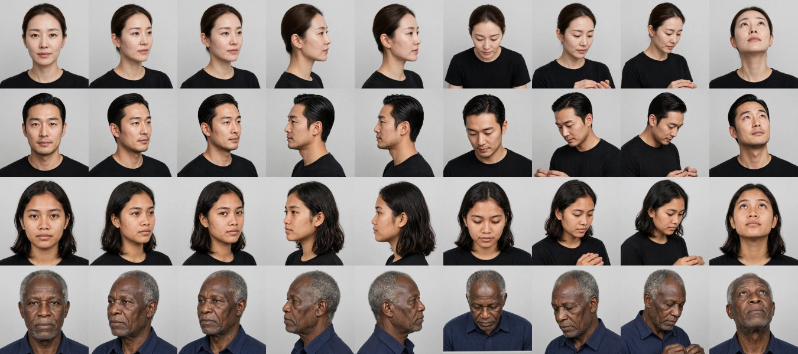
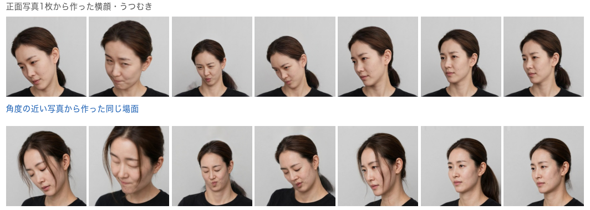
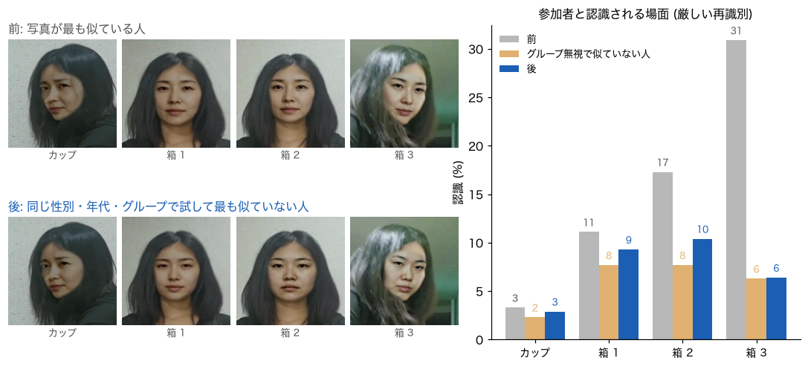

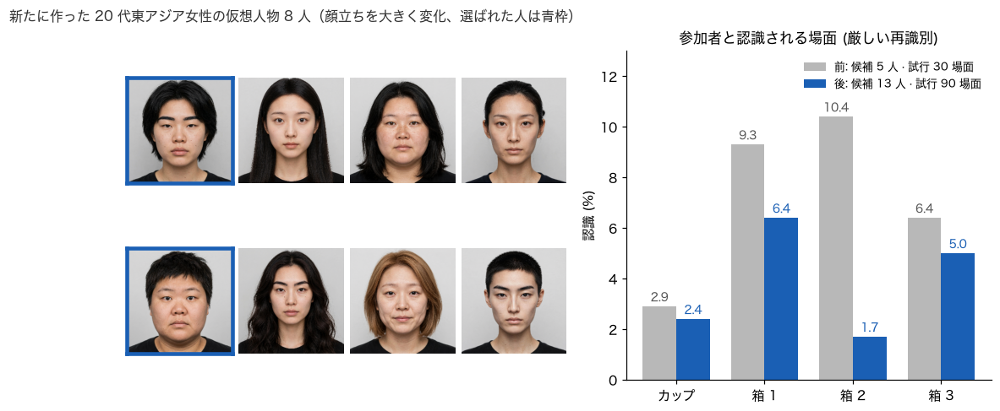

### 2. 5感の自動同期
手をたたく必要はありません：スマホ↔ウォッチの時計の往復、18〜20 kHz の音響ビーコン、ウォッチの振動パルス。実際のスマホ + ウォッチの録画 37 本のうち 24 本を音響ビーコンで合わせ（ペア残差 0.1〜1.9 ミリ秒）、残りはサーバー経由の時計で。この時計はビーコンより 24.7 ミリ秒（±3.5）ずれるため、機種の組み合わせごとに測って差し引きます（1 本ずつ抜いた検証で最大 9.2 ミリ秒）。測定は `docs/sync_eval.md`、コードは `datacash/sync/`。

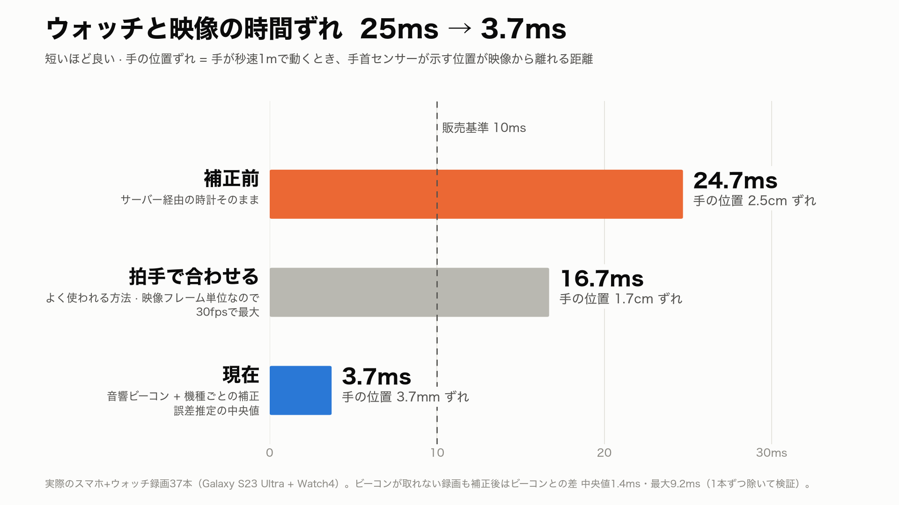

### 3. 手袋なしの触覚 —— 手首の GripSense
Goel・Wobbrock・Patel の *GripSense*（UIST 2012）を手首に移しました。ウォッチが短く振動すると、強く握るほど手が振動を吸収し、ジャイロの高周波が減り、指が踏ん張る 4〜12 Hz の震えが増えます。一人ひとりが自分で区別した強さ（離す・軽く・ふつう・ぎゅっと、はかり不要）で学習した決定木が、握る力のレベル 0〜3 を出します（`datacash/touch/`）。 Galaxy Watch4 で実測（IMU は最大 100 Hz、キャリブレーション録画 3 本、1 回目で学習して 2 回目を当て、逆も）：決定木 25 本 + 2 秒まとめで 4 段階 59%（当てずっぽう 25%、ぎゅっと 93%）、映像が手と物の接触を見ている間は回帰木 50 本が握る強さを 0〜100 の点数で出し（例：「中 (57)」）、低・中・高に区切ると 83%、点数の平均誤差 15 点。
心拍・拍動間隔・皮膚温度は Samsung Health Sensor SDK から（`docs/samsung_health_sdk.md`）。

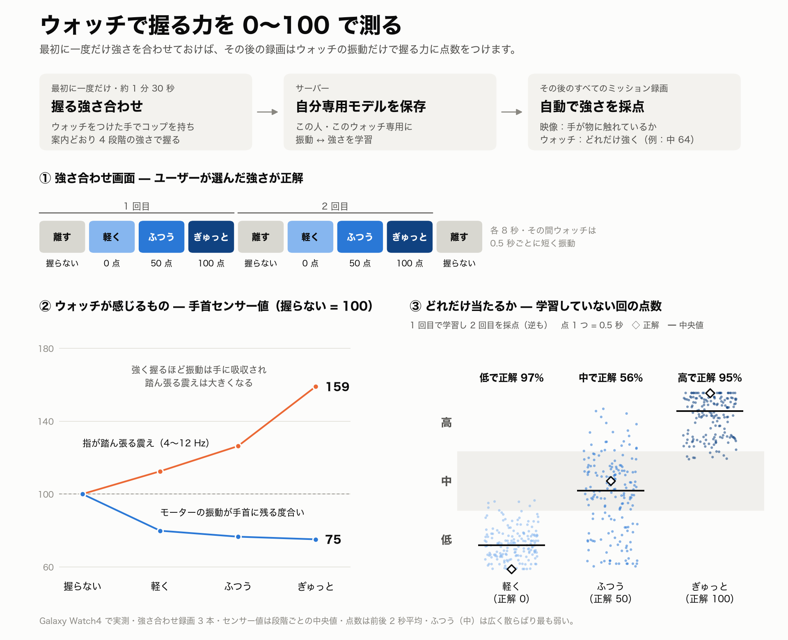

### 4. ふつうの言葉の依頼 → ミッション
企業が必要なものを書くと、Muse Spark（構造化出力）がミッション（動作・物体・変える条件）、参加条件（年齢・性別）、センサーの組み合わせを設計し、サーバーが予算に合わせて見積もりを出します。確定すると、条件に合う人のアプリにだけミッションが表示されます —— 依頼そのものが収集の分布になります。

### 5. 利益が残る処理コスト
- 使えない録画（短すぎる・手が見えない・暗すぎる）は、**API を呼ぶ前に**ローカルで差し戻し —— 0 ドル
- ローカルの物体検出で先に確認し、SAM には必要なものだけ（一人で撮った録画では「person」を問い合わせない、画面は映っているときだけ、動かない物は毎秒 1 フレーム）
- 実際の録画 4 本：SAM の費用 **2.92 → 0.27 ドル（−91%）**、映像 1 時間あたり約 5〜7 ドル（販売価格 約 43 ドル/時間）
- SAM マスクのデコードを Numba で書き直し：録画 1 本あたり 593 秒 → 8 秒、公式パーサーとビット単位で一致

## データセット（LeRobot v3.0）

`observation.images.ego`（隠した + 顔を置き換えた映像）· `observation.hands` · `observation.body` · `observation.face` · `observation.imu.phone` · `observation.imu.wrist` ·
`observation.audio` · **`observation.touch`**（接触、握る強さ 低・中・高 + 0〜100 点）· `observation.touch.vibration` · **`observation.physio`**（心拍、皮膚温度。生体情報に同意した人のみ）·
`observation.objects` · `annotation.step` · `annotation.primitive`（reach · grasp · … · release）· `sync.error_ms` + 品質証明書。
実際の `lerobot` 0.6.1 で読み込めます（`scripts/validate_lerobot.py`）。

企業はデータ 1 時間あたりのセンサーの組み合わせを選んで購入します —— 映像（必須）₩35,000 · 姿勢 ₩20,000 · 音 ₩5,000 · 手首 IMU ₩15,000 · 触覚 ₩25,000 · 生体情報 ₩50,000（`datacash/pricing.py`）。

## 構成

**全体の流れ** — 企業が言葉で依頼するとミッションが開き、参加者がスマホと時計で撮ってアップロードすると、サーバーが処理してデータを納品し報酬を払います。

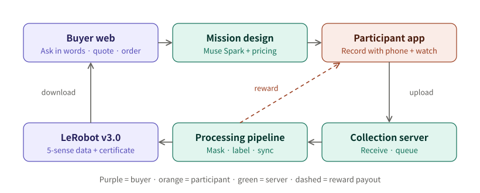

**録画1本の処理順** (`datacash/jobs.py`) — 費用のかからない処理を先に行い、使えない録画は Meta モデルを呼ぶ前に却下します。

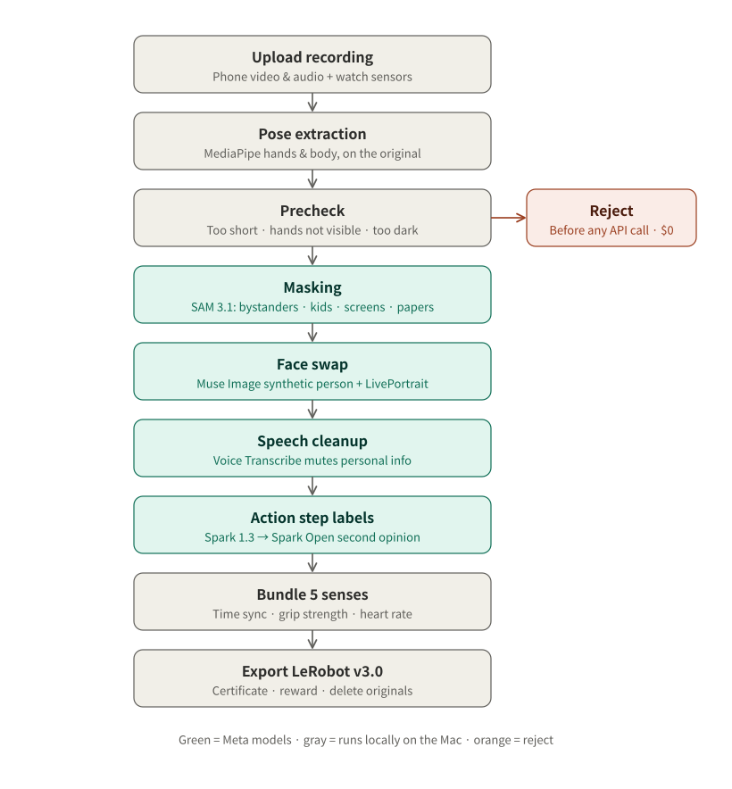

**技術スタックとデプロイ** — 現在は Docker やクラウドを使わず、Mac 1台がサーバーと処理をすべて担い、スマホと時計のアプリは同じ Wi-Fi 上で mDNS によりサーバーを見つけて直接アップロードします。

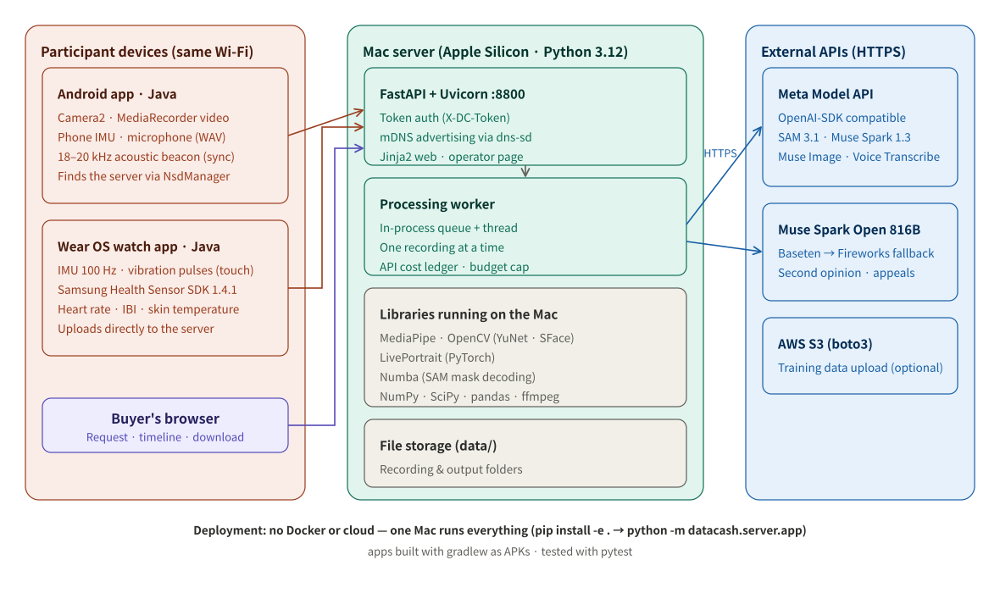

## 実行

```bash
python3.12 -m venv .venv && .venv/bin/pip install -e ".[dev]" torch pyyaml rich
echo "MODEL_API_KEY=..." > .env                       # リポジトリには入れない
# data/models：MediaPipe hand/pose/face landmarker .task、efficientdet_lite0.tflite、OpenCV yunet.onnx + sface.onnx
.venv/bin/python -m pytest                            # 正解がわかっている合成セッションで検証
DATACASH_TOKEN=... .venv/bin/python -m datacash.server.app --port 8800   # サーバー + 企業向け Web
cd app && ./gradlew assembleDebug                     # Android アプリ + ウォッチアプリ
```

LivePortrait はリポジトリに含めていません —— [KwaiVGI/LivePortrait](https://github.com/KwaiVGI/LivePortrait)（MIT）を入手し、`LP_ROOT` で指定してください。

## フォルダ

| フォルダ | 役割 |
|---|---|
| `app/` | Android アプリ（同意・ミッション・顔の確認・撮影・ミスの記録・質問・アップロード・報酬・異議申し立て）+ ウォッチアプリ |
| `web/` | 企業向け Web（ふつうの言葉の依頼・5感のタイムライン・見積もり・注文・ダウンロード）と運営画面 |
| `datacash/privacy` | SAM で隠す · 顔の置き換え · 音声のプライバシー · 事前スキャン |
| `datacash/sync` · `touch` · `labels` | センサー同期 · 触覚 · 手と体の姿勢 |
| `datacash/understand` | Muse Spark による理解 · Spark Open によるセカンドオピニオン · センサーによる検証 |
| `datacash/export` · `jobs.py` | LeRobot 出力 · 証明書 · 処理の流れ |
| `datacash/server` | 収集サーバー + 企業向け API |

## ドキュメント（韓国語）

- ハッカソン計画：[docs/1026_meta_hackathon.md](docs/1026_meta_hackathon.md) · 初日の記録：[docs/DAY1.md](docs/DAY1.md)
- 隠す処理と顔の置き換えの評価：[docs/privacy_eval.md](docs/privacy_eval.md) · Meta モデルの確認：[docs/model_check.md](docs/model_check.md)
- ウォッチ SDK：[docs/samsung_health_sdk.md](docs/samsung_health_sdk.md) · デモ動画の台本：[docs/demo_video_script.md](docs/demo_video_script.md)

## ハッカソン前 / ハッカソン中

| | 内容 |
|---|---|
| 前（10 月 26 日まで） | 計画書とブランド画像のみ。コードなし |
| 中（韓国時間 10 月 27 日 01:00 から） | このリポジトリのすべてのコード、アプリ、Web、Muse Image の人物、ドキュメント |

## ライセンスと出典

MediaPipe（Apache 2.0）· OpenCV YuNet と SFace（Apache 2.0）· LivePortrait（MIT）· LeRobot（Apache 2.0）· Numba（BSD）。
テスト映像は Wikimedia Commons（CC BY・CC BY-SA・パブリックドメインのみ、出典は `docs/privacy_eval.md`）のもので、リポジトリには入れていません。
Samsung Health Sensor SDK は規約に従いリポジトリに入れていません。
