[English](README.md) · **한국어** · [Español](README.es.md) · [中文](README.zh-CN.md) · [日本語](README.ja.md)

## DataCash Promotion Video

<p align="center">
  <a href="https://youtu.be/gw3gqoHlFvA">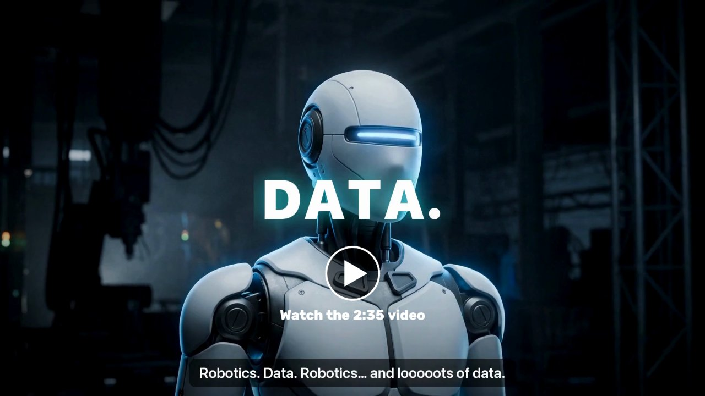</a>
</p>

## DataCash Technique Video

<p align="center">
  <a href="https://youtu.be/vClUIqrZjBY">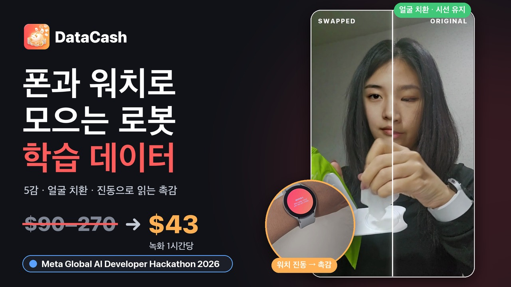</a>
</p>

<p align="center">3분 기술 데모 · <a href="https://youtu.be/vClUIqrZjBY">한국어</a> · <a href="https://youtu.be/o1sGUME0GHw">English</a></p>

---

# DataCash (데이터캐시)

**Physical AI 데이터 프로젝트**<br>
**집에 이미 있는 폰과 워치만으로, 로봇이 배울 사람의 손 데이터를 모은다.**

사람들은 집에서 로봇 기본 동작 미션을 폰과 워치로 찍고 보상을 받습니다.<br>
휴머노이드·피지컬 AI 기업은 **5감 데이터(시각·청각·촉각·움직임·생체)** 를 한 시간축에 맞춘 **LeRobot v3.0** 형식 그대로 구매할 수 있습니다.

Meta Global AI Developer Hackathon (Indie Developer)

<p align="center">
  
</p>

---

## How to run

심사 기간(11월 5~8일) 동안 바로 써 볼 수 있게 열어 두었어요. 설치할 서버는 없어요 — 클라우드에서 돌아가요.

| | 링크 |
|---|---|
| **웹** (구매 기업 화면: 말로 의뢰 · 예시 · 카탈로그 · 견적) | https://simhyojin024-datacash.hf.space |
| **운영자 화면** | https://simhyojin024-datacash.hf.space/admin — 비밀번호 **`admin`** |
| **사람 정답 달기** | https://simhyojin024-datacash.hf.space/label — 같은 비밀번호 |
| **폰 앱** (안드로이드 APK) | https://simhyojin024-datacash.hf.space/app.apk |
| **갤럭시 워치 앱** (Wear OS APK) | https://simhyojin024-datacash.hf.space/watch.apk |

**폰 (갤럭시):** 폰에서 APK 링크 열기 → 브라우저에 "출처를 알 수 없는 앱 설치" 허용 → DataCash 열기 → 얼굴 등록 → 미션 골라 녹화. 손과 물체가 화면에 나오게 찍어 주세요. 손이 거의 안 보이면 자동으로 반려돼요. 승인·보상·라벨은 몇 분 뒤 앱에 돌아와요.

**갤럭시 워치:** Wear OS 는 브라우저로 APK 를 설치할 수 없어서, 와이파이 adb 로 한 번 설치해야 해요. 워치에서 설정 → 워치 정보 → 소프트웨어 정보 → *소프트웨어 버전* 5번 누르기 → 개발자 옵션 → **ADB 디버깅**, **무선 디버깅** 켜기 → *새 기기 페어링*. 같은 와이파이의 컴퓨터에서:

```bash
adb pair <watch-ip>:<pairing-port>     # 워치에 뜬 6자리 코드 입력
adb connect <watch-ip>:<port>
adb install DataCash-Watch.apk
```

워치에서 DataCash 를 열면 시연 서버에 이미 연결돼 있어요. 폰에서 녹화를 시작하면 워치가 손목 움직임과 촉각을 같이 기록해요.

참고: 무료 CPU 서버라서 오래 안 쓰다가 처음 열면 깨어나는 데 1분쯤 걸릴 수 있어요. 올린 녹화는 서버가 다시 시작될 때까지 남아 있어요.

---

## 핵심 기술

### 1. 가상 인물 치환

- **얼굴 치환:** 블러 대신, 참여자 얼굴을 Muse Image 로 만든 가상 인물로 바꿉니다 (LivePortrait + MediaPipe).<br>
  같은 성별·비슷한 나이에서 후보를 고르고, 20장면을 시험으로 바꿔 봐서 얼굴 인식(SFace)이 '같은 사람'으로 보는 장면이 절반을 넘으면 다음 사람으로 치환합니다.
- **연속성:** 바꾼 얼굴이 너무 닮은 장면은 모자이크 대신 표정을 줄여 다시 만듭니다.
- **가리기:** SAM 3.1 로 데이터 수집에 동의하지 않은 사람·아이·화면·거울·액자·서류를 가립니다.
- **원본 삭제:** 서비스에서는 처리가 끝나면 원본 영상·소리를 바로 지웁니다.<br>
  해커톤 시연 서버는 원본↔치환 비교를 보여 주려고 이 호출만 꺼 두었습니다.

#### 얼굴 치환이 발전해 온 과정

| 날짜 | 바꾼 것 | 결과 |
|---|---|---|
| 10-27 | 블러 대신 가상 인물로 치환 (LivePortrait, Muse Image 가상 인물 34명), 장면마다 재식별 검사 | 얼굴은 남고 사람만 바뀜 · 387장면 중 모자이크 3 |
| 10-27 | 속도: 맥 GPU 에서 느린 Conv3d 를 2D 7번으로 나눔 + fp16 | 녹화 하나 636 → 84초 |
| 11-01 | 옆모습: 같은 가상 인물의 각도 사진 24장 (Muse Image 편집) → 장면 각도에 맞는 사진을 원본으로 | 숙인 고개·옆얼굴이 덜 일그러짐 |
| 11-01 | 가상 인물 고르기: 같은 성별·나이대·무리 안에서 후보마다 시험 장면을 실제로 바꿔 보고, 참여자와 가장 덜 닮은 사람 (동아시아 가상 인물 36명 추가, $9) | 엄격한 재식별로 알아보는 장면 3.3 / 11.1 / 17.3 / 30.9% → 2.4 / 6.4 / 1.7 / 5.0% |

<p align="center">
  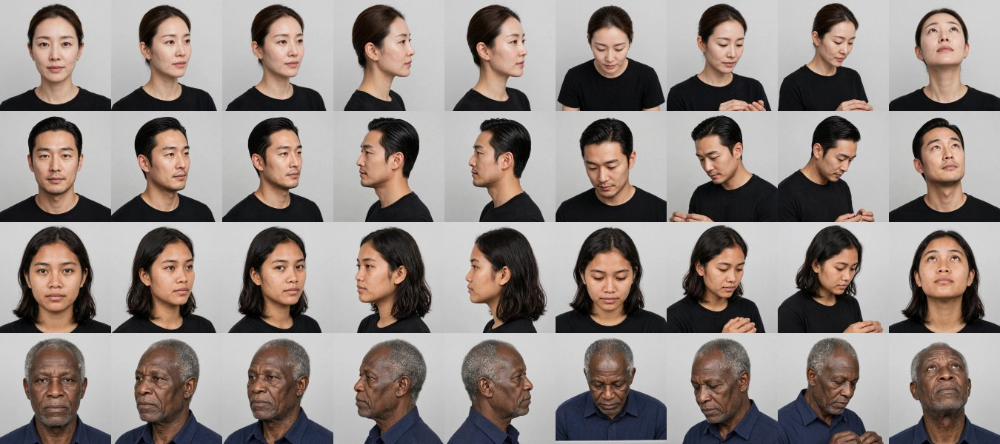<br>
  <sub>가상 인물마다 같은 사람의 여러 각도 사진</sub>
</p>

<p align="center">
  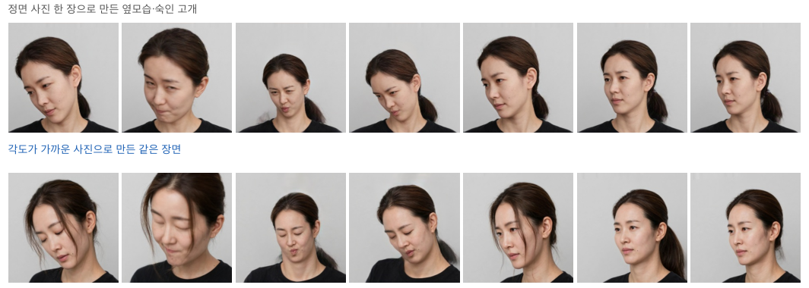<br>
  <sub>정면 사진 한 장으로 만든 옆모습 vs 각도가 가까운 사진으로 만든 같은 장면</sub>
</p>

<p align="center">
  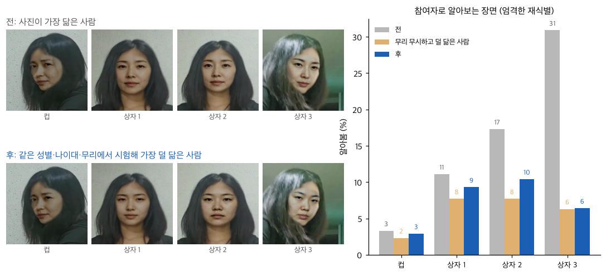<br>
  <sub>가상 인물 고르기 전·후: 알아보는 장면 비율</sub>
</p>

<p align="center">
  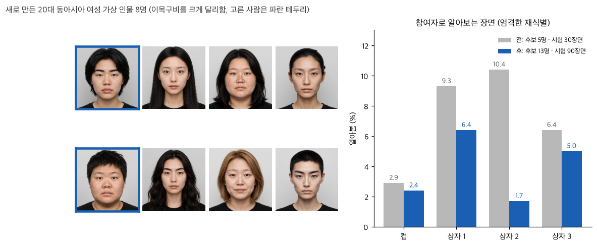<br>
  <sub>가상 인물을 늘린 뒤 알아보는 장면 전·후</sub>
</p>

### 2. 장갑 없는 촉각 — GripSense 방식

Goel·Wobbrock·Patel 의 *GripSense* (UIST 2012)를 손목으로 옮겨 촉각 측정에 이용했습니다.<br>
워치가 짧게 떨리면, 세게 쥘수록 손이 떨림을 흡수해 자이로 고주파가 줄고, 손가락이 버티는 4~12Hz 떨림은 커집니다.

<p align="center">
  
</p>

**Galaxy Watch4 실측** (IMU 최대 100Hz, 개인 보정 녹화 3편, 1회차로 학습 → 2회차로 평가, 반대로도 교차 검증)

- **분류:** 랜덤 포레스트(트리 25그루) + 2초 평활화로 4단계(안 쥠·가볍게·보통·꽉) 정확도 **59%** (무작위 25%, '꽉' 93%)
- **회귀:** 영상이 손-물체 접촉을 감지한 구간에서는 회귀 포레스트(트리 50그루)가 쥐는 세기를 0~100 연속 점수로 추정 (예: "중 (57)")<br>
  → 하·중·상 3구간으로 나누면 **83%**, 평균 절대 오차(MAE) 15점
- 워치 심박·박동 간격·피부 온도는 Samsung Health Sensor SDK 로 받습니다 (`docs/samsung_health_sdk.md`).

<p align="center">
  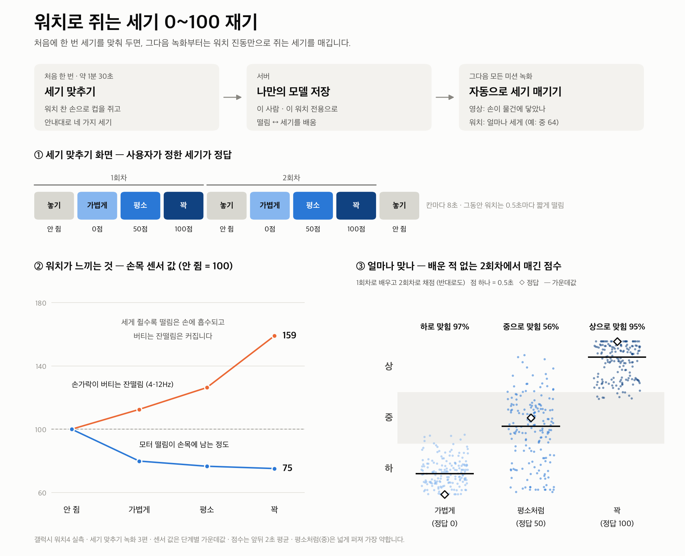
</p>

### 3. 5감 데이터 동기화

폰↔워치 시계 왕복, 18~20kHz 음향 비콘(고주파음), 워치 진동 펄스로 기기 사이 데이터의 싱크를 맞춥니다.

- 실제 폰 + 워치 녹화 37편 중 **24편을 음향 비콘으로** 맞췄습니다 (짝 잔차 0.1~1.9ms).
- 나머지는 서버를 거친 시계로 맞추되, 이 시계가 비콘보다 24.7ms(±3.5) 치우쳐 있어서 그 치우침을 기기 짝마다 재서 뺍니다.
- 결과: 워치 ↔ 영상 시간 오차 **24.7 → 3.7ms** (판매 기준 10ms)

<p align="center">
  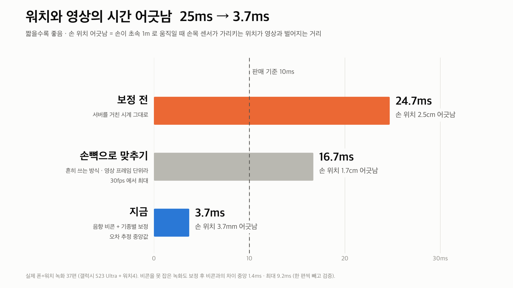
</p>

### 4. Spark 1.3 라벨링 정확도 향상

구간별·동작별 라벨링 정확도를 높이기 위해

1. 영상을 20초 조각·0.5배속으로 나눠 **5번 라벨링 후 비교 검증** (결과를 합쳐 한 순서를 고름)
2. 오픈웨이트 **Spark Open 816B 로 재검증** (동작이 바뀌는 경계 장면을 다시 고름)
3. **사람 라벨링 검증**
4. **Spark 를 이용한 미션별 라벨 자체 생성**

EPIC-KITCHENS-100 처음 보는 8구간(사람 정답 271단계) 기준 라벨링 정확도 **36% → 54% (+18%p)**, 경계 오차 **430 → 182ms**.

> Muse Wonderful 을 이용한 재검증도 고려했지만, 한국에서 지원되지 않아 오픈웨이트 모델을 사용했습니다.

### 5. Glimmer 를 활용한 API 절감

라벨링을 매번 Muse Spark API 에 맡기지 않도록, 오픈웨이트 Muse Glimmer 30B 를 우리 데이터로 학습시켰습니다 (Fireworks LoRA).<br>
Spark 가 라벨 초안을 만들고, 사람이 확인·수정한 단계를 정답으로 삼아 Glimmer 가 배웁니다.

- 학습 전 **41.8%** → 확인된 정답으로 학습 **54.1%** → 미션별 동작 순서를 이용한 풀이 추가 **64.1%**
- 앞으로 데이터가 쌓일수록 Glimmer 가 판단을 넘겨받아 Spark API 호출을 줄이고, 사업 이익률을 높일 수 있습니다.

### 6. SAM 물체 판단 비용 절감

- 쓸 수 없는 녹화(너무 짧음·손이 안 보임·어두움)는 **API 를 부르기 전에** 이 맥에서 반려합니다.
- 이 맥의 물체 찾기로 먼저 훑고, SAM 에는 필요한 것만 판단을 맡깁니다.<br>
  (혼자 찍으면 '사람'은 묻지 않음, 화면은 보일 때만, 정적인 물건은 초당 1장면)
- 실제 녹화 4편: SAM 비용 **$2.92 → $0.27 (−91%)**, 영상 1시간에 약 $5~7 (판매가 60,000원/시간)
- SAM 마스크 해독을 Numba 로 바꿔 처리 시간 **593초 → 8초**

---

## LeRobot 판매 데이터 (LeRobot v3.0)

<p align="center">
  
</p>

| 항목 | 내용 |
|---|---|
| 영상 | `observation.images.ego` (가린·치환 영상) |
| 관절 | `observation.hands` · `observation.body` · `observation.face` |
| 움직임 | `observation.imu.phone` · `observation.imu.wrist` |
| 소리 | `observation.audio` |
| 촉각 | **`observation.touch`** (접촉·쥐는 세기 하·중·상 + 0~100 점수) · `observation.touch.vibration` |
| 생체 | **`observation.physio`** (심박·피부 온도, 생체 동의한 경우만) |
| 물체·라벨 | `observation.objects` · `annotation.step` · `annotation.primitive` (reach·grasp·…·release) |
| 동기화 | `sync.error_ms` + 품질 인증서 |

실제 `lerobot` 0.6.1 로 읽힙니다 (`scripts/validate_lerobot.py`).

센서는 묶음으로 골라 삽니다 (시간당, `datacash/pricing.py`).

| 영상 (필수) | 관절 | 소리 | 손목 IMU | 촉각 | 생체 |
|---|---|---|---|---|---|
| 35,000원 | 20,000원 | 5,000원 | 15,000원 | 25,000원 | 50,000원 |

---

## 구조

**전체 흐름** — 기업이 말로 의뢰하면 미션이 열리고, 참여자가 폰·워치로 찍어 올리면 서버가 처리해 데이터로 납품하고 보상합니다.

<p align="center">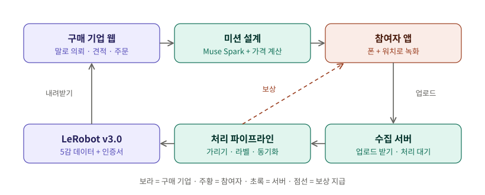</p>

**녹화 한 편의 처리 순서** (`datacash/jobs.py`) — 돈이 들지 않는 단계를 먼저 해서, 쓸 수 없는 녹화는 Meta 모델을 부르기 전에 반려합니다.

<p align="center">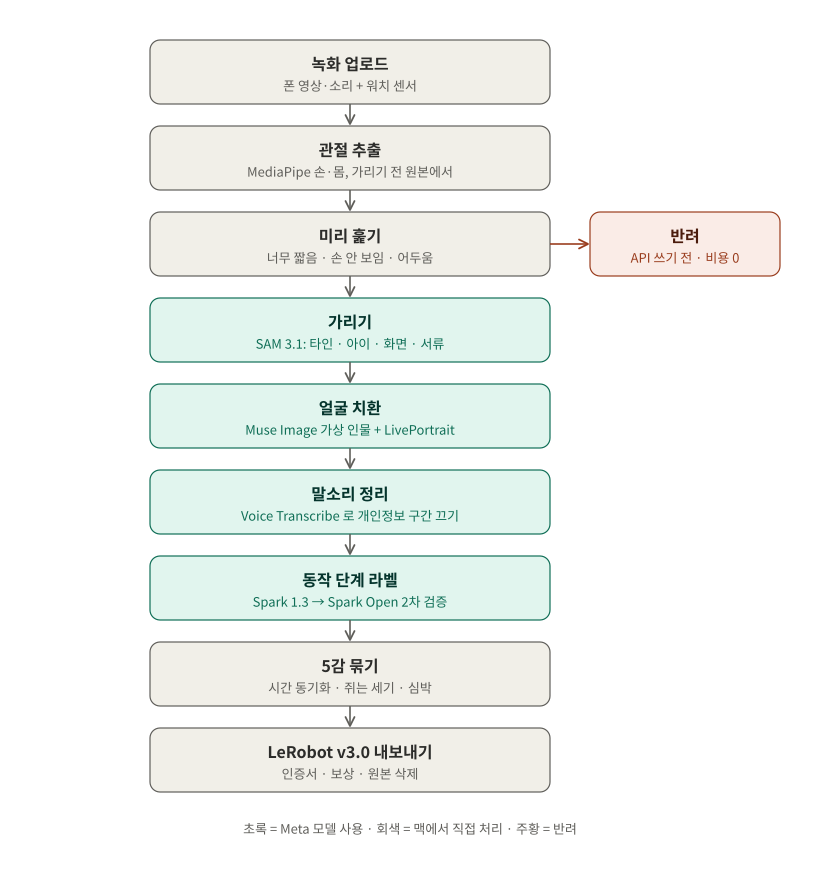</p>

**기술 스택과 배포** — 지금은 Docker·클라우드 없이 맥 한 대가 서버와 처리를 모두 맡고, 앱·워치는 같은 와이파이에서 mDNS 로 서버를 찾아 직접 올립니다.

<p align="center">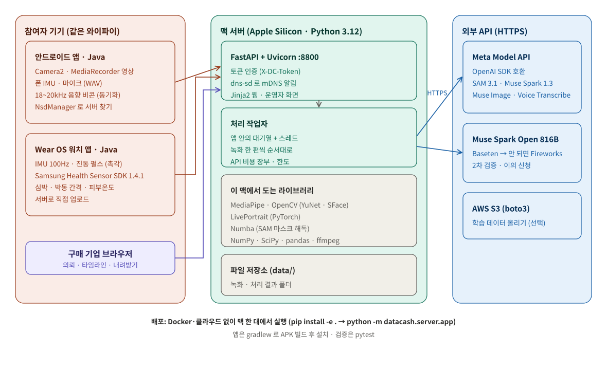</p>

## Run locally (내 컴퓨터에서 — 얼굴 치환까지)

얼굴 치환에는 GPU가 필요한데, 무료 클라우드 서버에는 GPU가 없어요. 가상 인물 얼굴 치환까지 전부 해 보려면 내 컴퓨터에서 서버를 켜세요. Apple Silicon 맥이나 NVIDIA GPU가 있는 PC면 돼요. 맥북에서 30초 녹화 하나에 약 6분 걸려요. 파이썬 3.12, git, **Meta Model API 키**가 필요해요. 키는 SAM 3.1 가리기와 Muse Spark 라벨에 쓰여요. 키가 없으면 녹화가 판매용 데이터로 만들어지지 않아요. `FIREWORKS_API_KEY`는 넣으면 Spark Open 2차 검증까지 해요 (선택).

```bash
git clone https://github.com/hyojin-shj/DataCash.git && cd DataCash
python3.12 -m venv .venv && .venv/bin/pip install -e . torch pyyaml rich huggingface_hub
.venv/bin/python scripts/fetch_models.py      # 모델 파일 + LivePortrait (약 700MB)
echo "MODEL_API_KEY=내-Meta-Model-API-키" > .env
DATACASH_TOKEN=정한-토큰 .venv/bin/python -m datacash.server.app --port 8800
```

- **웹 / 운영자:** http://localhost:8800 , http://localhost:8800/admin (비밀번호 = 정한 토큰)
- **폰:** 같은 와이파이에 연결 → DataCash → *스마트 기기 연결* → *데이터 서버*. `http://컴퓨터-IP:8800`와 토큰을 넣고 → *저장하고 연결 확인*. 맥에서는 `ipconfig getifaddr en0`로 IP를 볼 수 있어요.
- **워치:** How to run 처럼 adb로 설치한 뒤, 내 서버로 바꿔 주세요.

```bash
adb shell am start -n com.datacash.wear/.WatchActivity --es server http://컴퓨터-IP:8800 --es token 정한-토큰
```

## 폴더

| 폴더 | 하는 일 |
|---|---|
| `app/` | 안드로이드 앱(동의·미션·얼굴 확인·녹화·실수 표시·질문·업로드·보상·이의 신청) + 워치 앱 |
| `web/` | 구매 기업 웹(말로 의뢰·5감 타임라인·견적·주문·내려받기), 운영자 화면 |
| `datacash/privacy` | SAM 가리기 · 얼굴 치환 · 소리 개인정보 · 미리 훑기 |
| `datacash/sync` · `touch` · `labels` | 5감 동기화 · 촉각 · 손·몸 관절 |
| `datacash/understand` | Muse Spark 이해 · Spark Open 2차 검증 · 감각으로 검증 |
| `datacash/export` · `jobs.py` | LeRobot 내보내기 · 인증서 · 처리 순서 |
| `datacash/server` | 수집 서버 + 구매 기업 API |

## Meta 모델 이용

| 모델 | 쓰임 |
|---|---|
| **SAM 3.1** | 동의하지 않은 사람·아이·화면·거울·액자·서류 가리기, 다루는 물체·동작 인식 |
| **Muse Spark 1.3** | 가린 영상 → 단계·지시문·쓰는 손·물체·실수 라벨링<br>기업의 말 의뢰 → 미션 설계 → 미션별 라벨 생성 |
| **Muse Image** | 실존하지 않는 가상 인물 70명 생성 (얼굴 치환용), 사람마다 같은 사람의 각도 사진 24장 |
| **Muse Voice Transcribe** | 녹화 소리에서 개인정보가 들린 구간 끄기 |
| **Muse Spark Open** | 녹화의 2차 검증과 이의 신청을 다시 보는 '더 높은 모델'.<br>두 모델이 다르게 본 단계는 바로잡고, 같게 보고 센서로 검증된 단계는 정답 예시가 되어 다음 녹화의 Spark 1.3 질문에 붙습니다. |
| **Muse Glimmer 30B** | Spark 1.3 초안과 사람이 검증한 라벨로 영상 인식을 학습합니다.<br>데이터가 모일수록 성능이 개선되어 API 의존도를 낮출 수 있습니다. |

## 측정한 성능

| 무엇 | 처음 → 지금 | 잰 곳 |
|---|---|---|
| 단계 라벨 장면 정확도 (Muse Spark 1.3) | **35.6% → 54.3%** | EPIC-KITCHENS-100 새 8구간, 사람 정답 271단계 |
| 단계 경계 오차 (중앙값) | **430 → 182ms** | 같음 |
| Muse Glimmer 30B 단계 정확도 (LoRA, Fireworks) | **41.8% → 54.1% → 64.1%**<br>(v80 사람 정답으로 학습 · v82 + 미션별 순서 디코딩, 범위 60.7–67.2% · Spark 라벨로 학습한 v79 는 32.8%) | 학습에 안 쓴 녹화 8편의 사람 정답 122단계 |
| 워치 ↔ 영상 시간 오차 | **24.7 → 3.7ms** (기준 10ms) | 폰 + 워치 녹화 37편 |
| 녹화 하나 얼굴 치환 시간 | **636 → 84초** (7.5배) | `docs/privacy_eval.md` |
| SAM 3.1 비용, 녹화 4편 | **$2.92 → $0.27** (−91%) | 실제 녹화 4편 |
| 쥐는 세기 하·중·상 | **83%** (우연 33%) | 보정 녹화 3편, 갤럭시 워치4 |

<p align="center">
  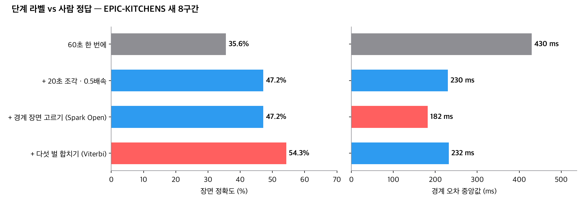<br><br>
  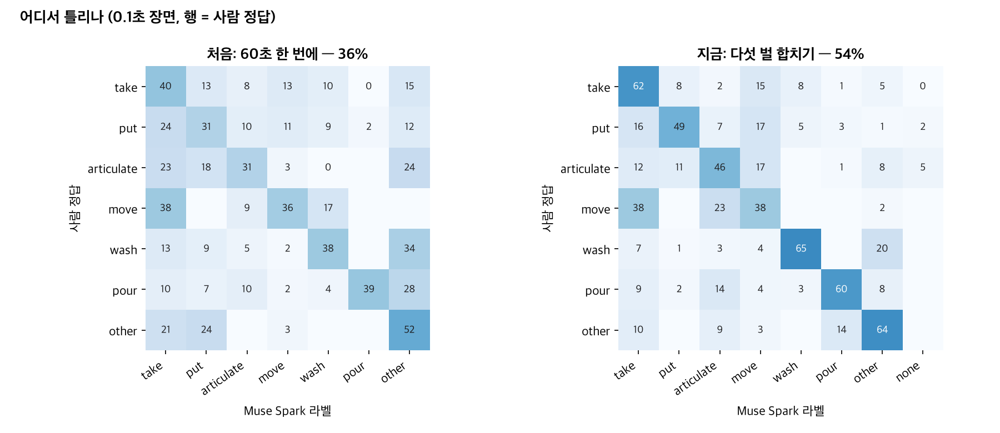<br><br>
  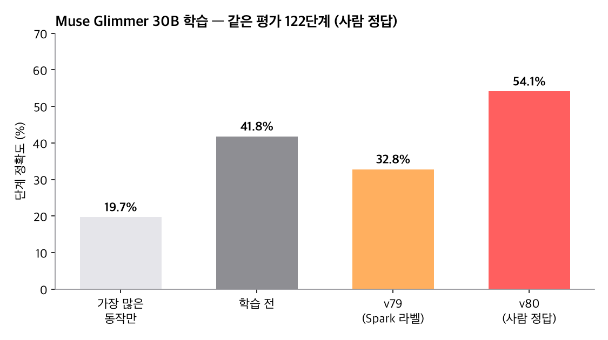<br><br>
  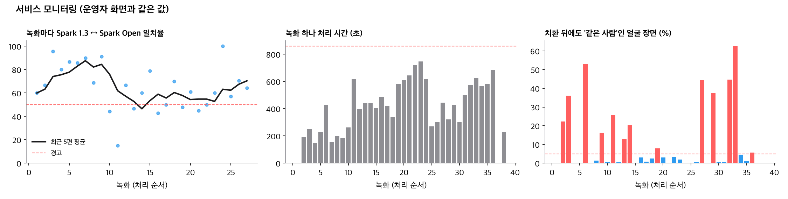
</p>

**서비스 모니터링** (운영자 화면과 같은 값, `datacash/perf.py`) — 기준을 넘으면 경고하고, 그 녹화는 검토 대상이 됩니다.

- 녹화마다 Spark 1.3 ↔ Spark Open 일치율과 최근 5편 평균 — 50% 아래면 경고
- 녹화 하나 처리 시간 — 중앙값의 2배를 넘으면 경고
- 얼굴 치환 뒤에도 같은 사람으로 보이는 장면 (SFace 0.363) — 5% 넘으면 경고

---

## 해커톤 전 / 해커톤 중

| | 내용 |
|---|---|
| 해커톤 전 (10-26 이전) | 계획 문서와 브랜드 이미지만. 코드 없음 |
| 해커톤 중 (한국 10-27 01:00 부터) | 이 저장소의 모든 코드 · 앱 · 웹 · Muse Image 가상 인물 · 문서 |

## 라이선스·출처

MediaPipe (Apache 2.0) · OpenCV YuNet·SFace (Apache 2.0) · LivePortrait (MIT) · LeRobot (Apache 2.0) · Numba (BSD)<br>
시험 영상은 Wikimedia Commons (CC BY·CC BY-SA·퍼블릭 도메인만, 출처는 `docs/privacy_eval.md`)<br>
Samsung Health Sensor SDK
