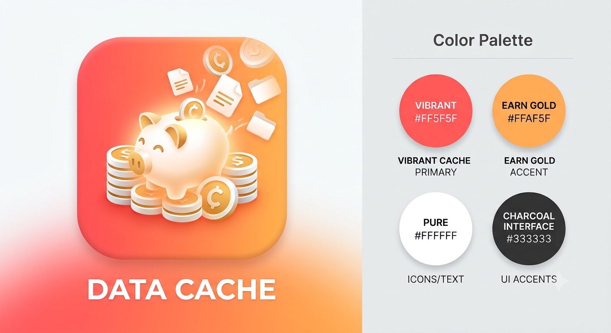

# DataCache (데이터캐시)

집에 이미 있는 기기(폰·워치)만으로 **촉각·시각·청각·몸 감각**을 한 시간축에 모으는 생활밀착형 고품질 로봇 데이터 양산소.
집에서 미션을 찍으면 보상을 받고, 개인정보를 지운 '사람이 어떻게 움직이고 반응했나' 데이터를 휴머노이드·피지컬 AI 회사가
LeRobot 형식으로 바로 사는 플랫폼. Meta Global AI Developer Hackathon (Indie Developer · Push the Frontier) 출품작.

## 해커톤 계획

**[docs/1026_meta_hackathon.md](docs/1026_meta_hackathon.md)** — 기획 · 핵심 기술 · 데이터 목표 11가지 · 등급과 가격 · 경쟁 차별점 ·
치환 근거 논문 · Meta 모델(SAM 3.1 · Muse Spark 1.3 · Muse Image · Muse Voice Transcribe · Muse Glimmer) 쓰임 · 전략 ·
날짜별 계획 · 3분 시연 · 위험과 대비

## 해커톤 전 / 해커톤 중

| | 내용 |
|---|---|
| 해커톤 전 (10-26 이전) | 계획 문서와 브랜드 이미지만. 코드는 없다. 가져와 쓰는 자산은 계획 문서 1-1 표에 출처와 함께 밝힌다 |
| 해커톤 중 (한국 10-27 01:00 = 10-26 정오 ET 부터) | 이 저장소의 모든 코드 |
