**English** · [한국어](README.ko.md) · [Español](README.es.md) · [中文](README.zh-CN.md) · [日本語](README.ja.md)

## DataCash Promotion Video

<p align="center">
  <a href="https://youtu.be/gw3gqoHlFvA">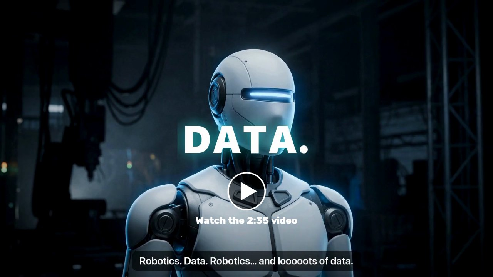</a>
</p>

## DataCash Technique Video

<p align="center">
  <a href="https://youtu.be/o1sGUME0GHw">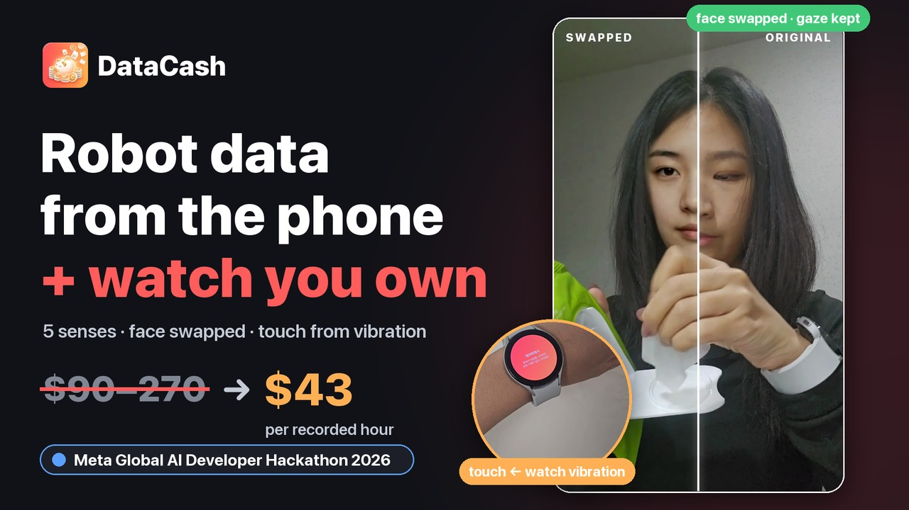</a>
</p>

<p align="center">3-minute technique demo · <a href="https://youtu.be/o1sGUME0GHw">English</a> · <a href="https://youtu.be/vClUIqrZjBY">한국어</a></p>

---

# DataCash

**A Physical AI data project**<br>
**Collecting the human hand data robots learn from — using only the phone and watch people already have at home.**

People record basic robot-skill missions at home with their phone and watch, and get rewarded.<br>
Humanoid and physical-AI companies can buy **five-sense data (vision, sound, touch, motion, physiology)**, aligned on one timeline, ready to use in **LeRobot v3.0** format.

Meta Global AI Developer Hackathon (Indie Developer)

<p align="center">
  
</p>

---

## Core technology

### 1. Synthetic-person replacement

- **Face replacement:** instead of blurring, the contributor's face is replaced with a synthetic person made with Muse Image (LivePortrait + MediaPipe).<br>
  Candidates are chosen from the same gender and a similar age; we test-swap 20 frames, and if face recognition (SFace) calls more than half of them "the same person", we move on to the next person.
- **Continuity:** frames where the swapped face still looks too similar are regenerated with a softer expression instead of being pixelated.
- **Masking:** SAM 3.1 masks people who did not consent to data collection, children, screens, mirrors, picture frames and documents.
- **Originals deleted:** in the service, raw video and audio are deleted as soon as processing ends.<br>
  On the hackathon demo server only this call is switched off, to show the original-vs-replaced comparison.

#### How the face replacement evolved

| Date | Change | Result |
|---|---|---|
| 10-27 | Replace with a synthetic person instead of blurring (LivePortrait, 34 Muse Image synthetic people), re-identification check on every frame | The face stays, only the person changes · 3 of 387 frames pixelated |
| 10-27 | Speed: split the slow Conv3d on Mac GPU into 7 2D convolutions + fp16 | One recording 636 → 84 s |
| 11-01 | Profiles: 24 angle photos of the same synthetic person (Muse Image edits) → the photo matching the frame's angle is used as the source | Bowed heads and profiles are less distorted |
| 11-01 | Picking the synthetic person: within the same gender, age band and group, trial-swap each candidate on test frames and take the one least like the contributor (+36 East Asian synthetic people, $9) | Frames recognized under strict re-identification 3.3 / 11.1 / 17.3 / 30.9% → 2.4 / 6.4 / 1.7 / 5.0% |

<p align="center">
  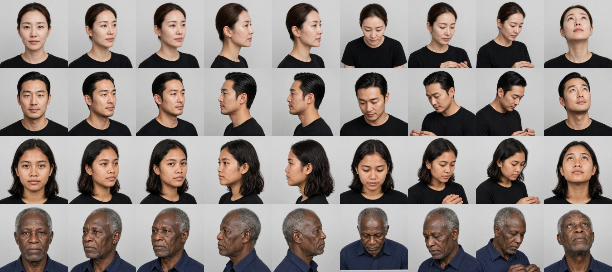<br>
  <sub>Several angle photos of the same person, for each synthetic person</sub>
</p>

<p align="center">
  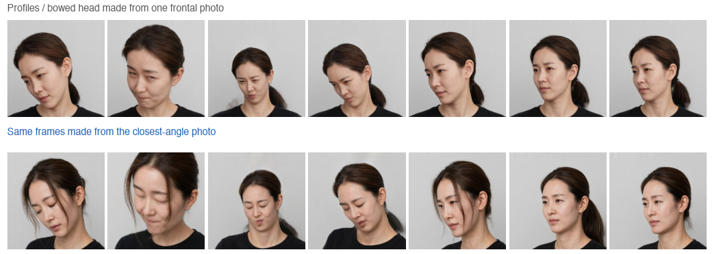<br>
  <sub>Profile made from one frontal photo vs the same frame made from the closest-angle photo</sub>
</p>

<p align="center">
  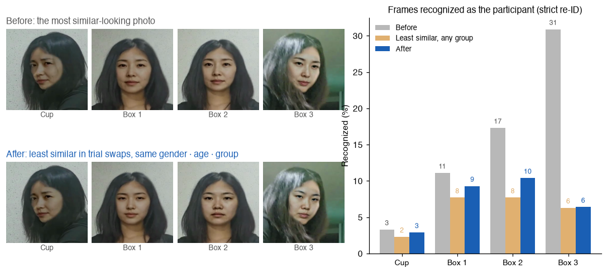<br>
  <sub>Before and after the new synthetic-person selection: recognized-frame rate</sub>
</p>

<p align="center">
  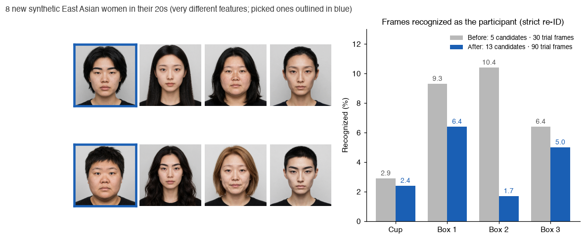<br>
  <sub>Recognized frames before and after adding more synthetic people</sub>
</p>

### 2. Touch without a glove — the GripSense approach

We moved Goel, Wobbrock & Patel's *GripSense* (UIST 2012) to the wrist and use it to measure touch.<br>
When the watch buzzes briefly, the tighter the grip, the more the hand absorbs the vibration: high-frequency gyro energy drops, while the 4–12 Hz tremor of fingers holding on rises.

<p align="center">
  
</p>

**Measured on a Galaxy Watch4** (IMU capped at 100 Hz, 3 personal calibration recordings, train on round 1 → test on round 2, and cross-validated the other way)

- **Classification:** a random forest (25 trees) + 2-second smoothing reaches **59%** accuracy on 4 levels (release · light · normal · tight) (chance 25%, tight 93%)
- **Regression:** while the video detects hand–object contact, a regression forest (50 trees) estimates grip force as a continuous 0–100 score (e.g. "mid (57)")<br>
  → cut into low · mid · high it reaches **83%**, mean absolute error (MAE) 15 points
- Heart rate, beat-to-beat intervals and skin temperature from the watch come from the Samsung Health Sensor SDK (`docs/samsung_health_sdk.md`).

<p align="center">
  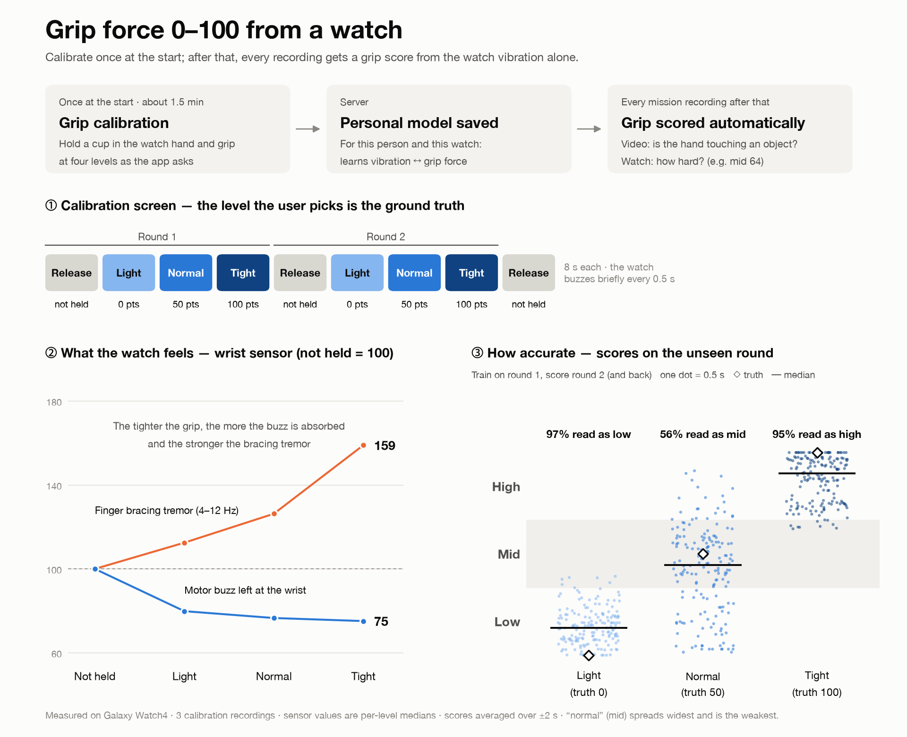
</p>

### 3. Five-sense data sync

Data across devices is synced with phone↔watch clock round-trips, an 18–20 kHz acoustic beacon (high-frequency tone) and watch vibration pulses.

- Of 37 real phone + watch recordings, **24 were aligned with the acoustic beacon** (pair residual 0.1–1.9 ms).
- The rest are aligned with the server-relayed clock; since that clock runs 24.7 ms (±3.5) off the beacon, the bias is measured per device pair and subtracted.
- Result: watch ↔ video time error **24.7 → 3.7 ms** (sale threshold 10 ms)

<p align="center">
  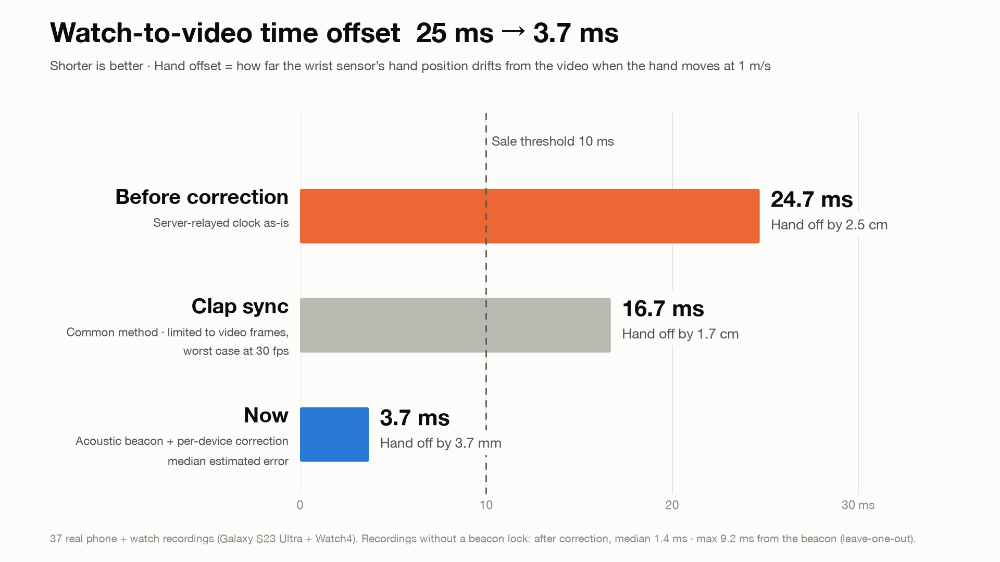
</p>

### 4. Better Spark 1.3 labeling accuracy

To raise labeling accuracy per segment and per action:

1. The video is split into 20-second chunks at 0.5× speed and **labeled 5 times, then cross-checked** (the results are merged into one sequence)
2. **Re-verified with the open-weights Spark Open 816B** (re-picks the boundary frames where the action changes)
3. **Human label verification**
4. **Per-mission labels generated by Spark itself**

On 8 unseen EPIC-KITCHENS-100 clips (271 human-labeled steps), labeling accuracy went **36% → 54% (+18 pp)** and boundary error **430 → 182 ms**.

> We also considered re-verification with Muse Wonderful, but it is not available in Korea, so we used an open-weights model.

### 5. Cutting API cost with Glimmer

So that labeling doesn't go to the Muse Spark API every time, we trained the open-weights Muse Glimmer 30B on our own data (Fireworks LoRA).<br>
Spark drafts the labels, and Glimmer learns from the steps that humans have checked and corrected as ground truth.

- Before training **41.8%** → trained on verified ground truth **54.1%** → with per-mission action-order decoding **64.1%**
- As data accumulates, Glimmer can take over these decisions, reducing Spark API calls and raising the business margin.

### 6. Cutting SAM object-detection cost

- Unusable recordings (too short, hands not visible, too dark) are rejected on this Mac **before any API call**.
- A local object detector on this Mac scans first, and SAM only gets the decisions that are needed.<br>
  (no "person" query for solo recordings, screens only when visible, static objects at 1 frame per second)
- On 4 real recordings: SAM cost **$2.92 → $0.27 (−91%)**, about $5–7 per hour of video (sold at ₩60,000/hour (~$43))
- SAM mask decoding rewritten with Numba: processing time **593 s → 8 s**

---

## LeRobot data for sale (LeRobot v3.0)

<p align="center">
  
</p>

| Item | Contents |
|---|---|
| Video | `observation.images.ego` (masked + face-replaced video) |
| Pose | `observation.hands` · `observation.body` · `observation.face` |
| Motion | `observation.imu.phone` · `observation.imu.wrist` |
| Sound | `observation.audio` |
| Touch | **`observation.touch`** (contact, grip low · mid · high + 0–100 score) · `observation.touch.vibration` |
| Physiology | **`observation.physio`** (heart rate, skin temperature; biometric consent only) |
| Objects & labels | `observation.objects` · `annotation.step` · `annotation.primitive` (reach · grasp · … · release) |
| Sync | `sync.error_ms` + quality certificate |

Loads with the real `lerobot` 0.6.1 (`scripts/validate_lerobot.py`).

Sensors are bought as packs (per hour, `datacash/pricing.py`).

| Video (required) | Pose | Sound | Wrist IMU | Touch | Physiology |
|---|---|---|---|---|---|
| ₩35,000 | ₩20,000 | ₩5,000 | ₩15,000 | ₩25,000 | ₩50,000 |

---

## Architecture

**Overall flow** — a company makes a request in plain words, missions open, participants record with phone and watch and upload, and the server processes the recordings, delivers the data and pays the rewards.

<p align="center">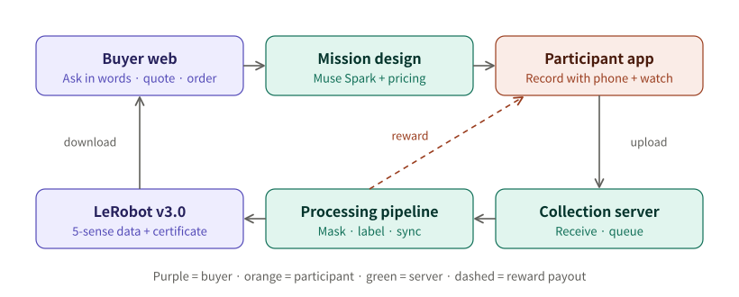</p>

**How one recording is processed** (`datacash/jobs.py`) — free steps run first, so unusable recordings are rejected before any Meta model is called.

<p align="center">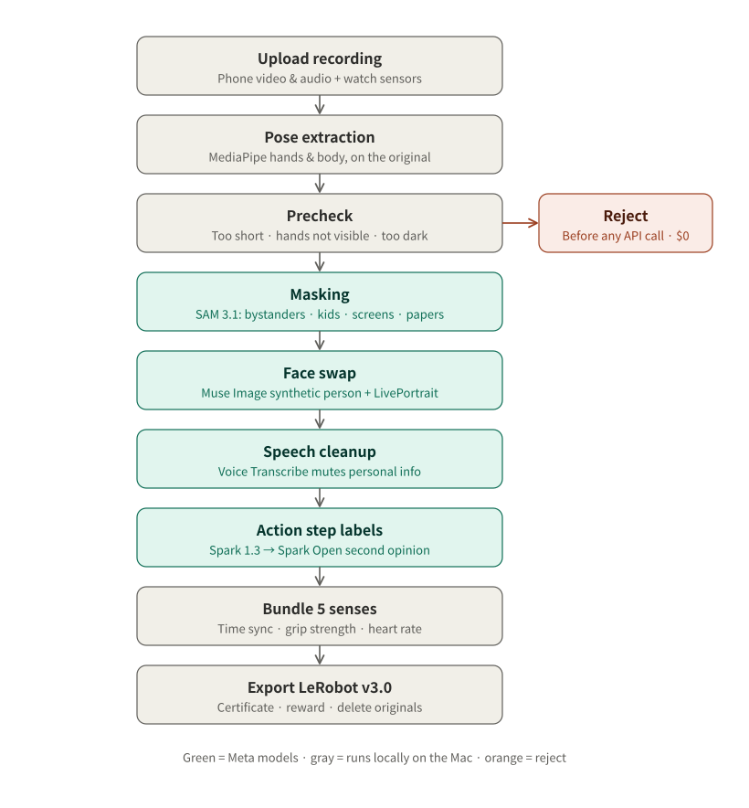</p>

**Tech stack and deployment** — today there is no Docker or cloud: one Mac runs both the server and all processing, and the app and watch find the server over mDNS on the same Wi-Fi and upload directly.

<p align="center">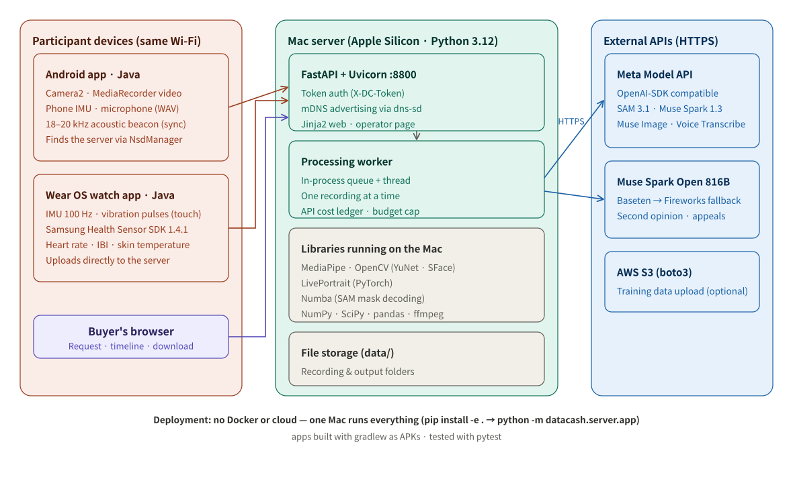</p>

## Run it

```bash
python3.12 -m venv .venv && .venv/bin/pip install -e ".[dev]" torch pyyaml rich
echo "MODEL_API_KEY=..." > .env                       # never committed to the repo
# data/models: MediaPipe hand/pose/face landmarker .task, efficientdet_lite0.tflite, OpenCV yunet.onnx + sface.onnx
.venv/bin/python -m pytest                            # verified on synthetic five-sense sessions with known ground truth
DATACASH_TOKEN=... .venv/bin/python -m datacash.server.app --port 8800   # server + buyer web
cd app && ./gradlew assembleDebug                     # Android app + watch app
```

## Layout

| Folder | What it does |
|---|---|
| `app/` | Android app (consent, missions, face check, recording, mistake marks, questions, upload, rewards, appeals) + watch app |
| `web/` | Buyer web (plain-language requests, five-sense timeline, quotes, orders, downloads) and operator console |
| `datacash/privacy` | SAM masking · face replacement · speech privacy · pre-scan |
| `datacash/sync` · `touch` · `labels` | Five-sense sync · touch · hand and body pose |
| `datacash/understand` | Muse Spark understanding · Spark Open second opinion · sensor-based verification |
| `datacash/export` · `jobs.py` | LeRobot export · certificate · processing pipeline |
| `datacash/server` | Collection server + buyer API |

## Meta models used

| Model | Role |
|---|---|
| **SAM 3.1** | Masks non-consenting people, children, screens, mirrors, picture frames and documents; recognizes handled objects and actions |
| **Muse Spark 1.3** | Masked video → labels for steps, instructions, active hand, objects and mistakes<br>A company's plain-language request → mission design → per-mission label generation |
| **Muse Image** | Generates 70 synthetic people who don't exist (for face replacement), with 24 angle photos of each |
| **Muse Voice Transcribe** | Mutes the parts of a recording where personal information is spoken |
| **Muse Spark Open** | The "higher model" for second-opinion review of recordings and for appeals.<br>Steps where the two models disagree are corrected; steps they agree on and that are sensor-verified become gold examples added to Spark 1.3's prompts for the next recordings. |
| **Muse Glimmer 30B** | Learns video understanding from Spark 1.3 drafts and human-verified labels.<br>Performance improves as data accumulates, reducing dependence on the API. |

## Measured performance

| What | Before → now | Measured on |
|---|---|---|
| Step-label frame accuracy (Muse Spark 1.3) | **35.6% → 54.3%** | 8 new EPIC-KITCHENS-100 clips, 271 human-labeled steps |
| Step boundary error (median) | **430 → 182 ms** | same |
| Muse Glimmer 30B step accuracy (LoRA, Fireworks) | **41.8% → 54.1% → 64.1%**<br>(v80 trained on human ground truth · v82 + per-mission order decoding, range 60.7–67.2% · v79 trained on Spark labels: 32.8%) | 122 human-labeled steps from 8 recordings not used in training |
| Watch ↔ video time error | **24.7 → 3.7 ms** (threshold 10 ms) | 37 phone + watch recordings |
| Face replacement time per recording | **636 → 84 s** (7.5×) | `docs/privacy_eval.md` |
| SAM 3.1 cost, 4 recordings | **$2.92 → $0.27** (−91%) | 4 real recordings |
| Grip level low · mid · high | **83%** (chance 33%) | 3 calibration recordings, Galaxy Watch4 |

<p align="center">
  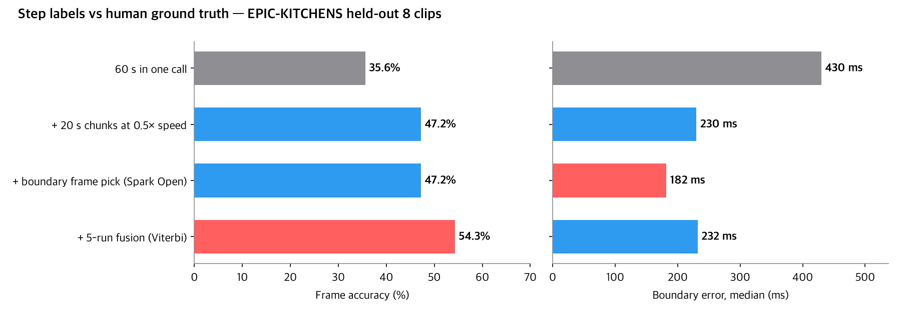<br><br>
  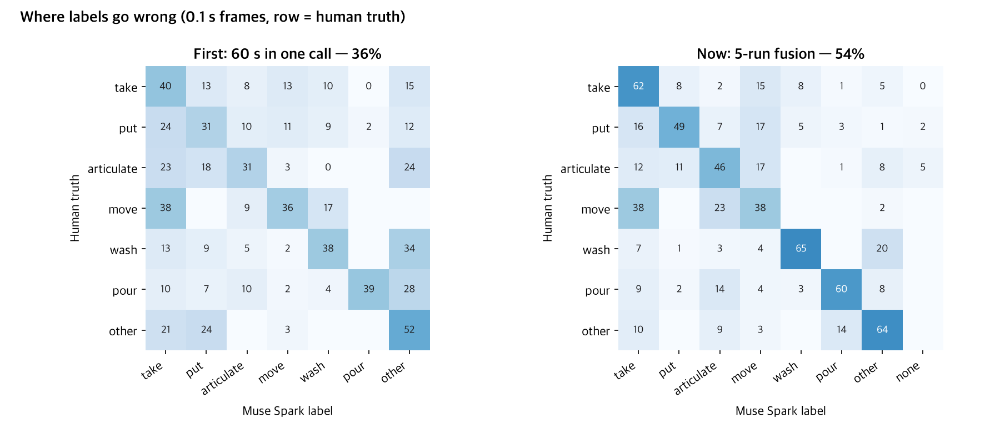<br><br>
  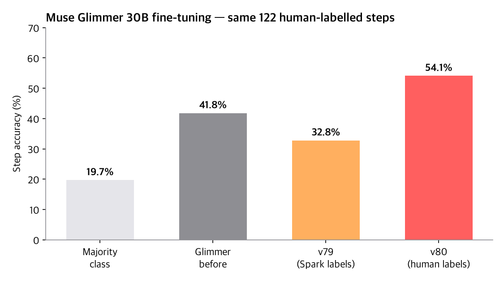<br><br>
  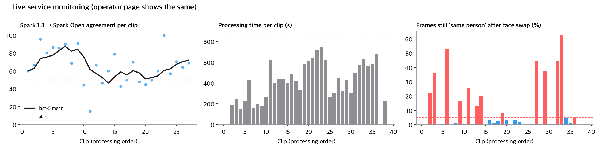
</p>

**Service monitoring** (same values as the operator console, `datacash/perf.py`) — an alert fires when a threshold is crossed, and that recording is flagged for review.

- Spark 1.3 ↔ Spark Open agreement per recording and the mean of the last 5 — alert below 50%
- Processing time per recording — alert above 2× the median
- Frames that still look like the same person after face replacement (SFace 0.363) — alert above 5%

---

## Before vs. during the hackathon

| | Contents |
|---|---|
| Before the hackathon (until 10-26) | Planning document and brand image only. No code |
| During the hackathon (from 10-27 01:00 KST) | All code, app, web, Muse Image synthetic people and docs in this repository |

## Licenses and sources

MediaPipe (Apache 2.0) · OpenCV YuNet & SFace (Apache 2.0) · LivePortrait (MIT) · LeRobot (Apache 2.0) · Numba (BSD)<br>
Test videos are from Wikimedia Commons (CC BY, CC BY-SA or public domain only; sources in `docs/privacy_eval.md`)<br>
Samsung Health Sensor SDK
