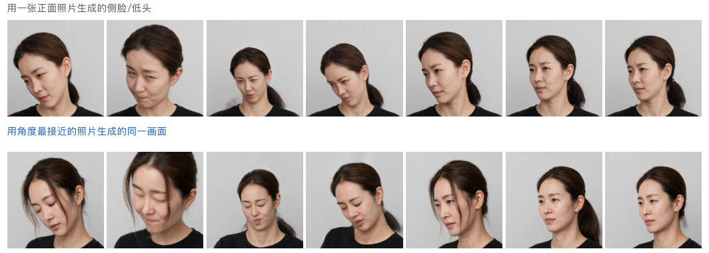
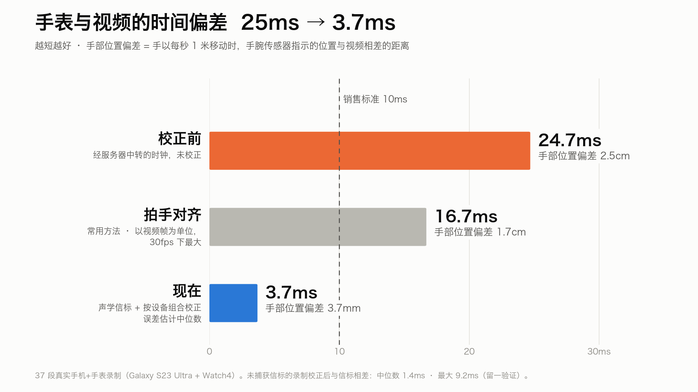
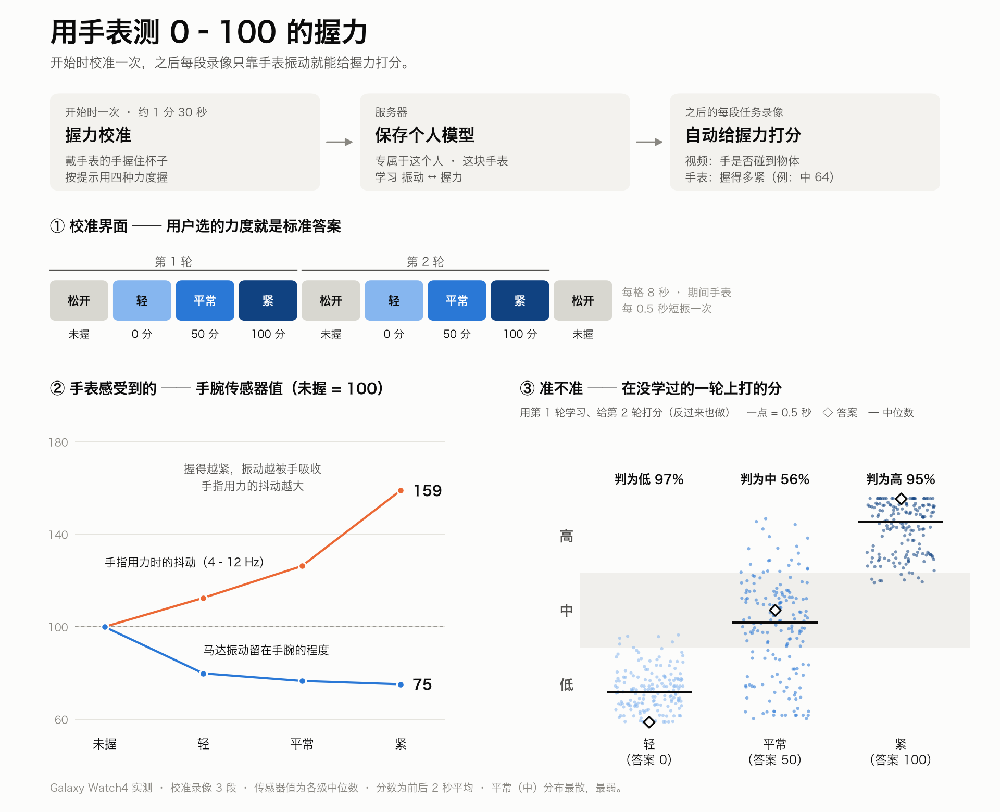

[English](README.md) · [한국어](README.ko.md) · [Español](README.es.md) · **中文** · [日本語](README.ja.md)

[](https://youtu.be/gw3gqoHlFvA)

# DataCash

**只用大家手里已有的手机和手表，收集机器人学习所需的人手数据。**

普通人在家用手机和智能手表录制简短的机器人基础动作任务（抽纸巾、移杯子、拧盖子等共 12 种），并获得报酬。
人形机器人和具身智能公司购买的结果是：去除个人信息的 **五感数据 —— 视觉、听觉、触觉（握力）、动作和生理（心率）**，统一在同一时间轴上，
以可直接训练的 **LeRobot v3.0** 数据集交付。

Meta Global AI Developer Hackathon（Indie Developer · Push the Frontier）参赛作品。


## 一览

| | |
|---|---|
| 录制者 | 安卓 App + 手表 App。选择任务 → 人脸确认 → 录制 → 回答 1–2 个问题 → “叮”，报酬到账 |
| 购买企业 | 在网页上**用自然语言提需求**（“仓库机器人用的搬箱子数据，20–50 岁，预算 3,000 美元”）→ AI 设计任务并向全世界开放 |
| 隐私 | 参与者的脸被换成**不存在的人**；未同意的路人、屏幕和文件被遮盖；处理完成后删除原始文件 |
| 触觉 | 不用手套 —— **手表自己振动，测量手吸收了多少振动**来估计握力（GripSense，UIST 2012） |

## Meta 模型用在哪里

| 模型 | 用途 | 代码 |
|---|---|---|
| **SAM 3.1** | 遮盖未同意的人、儿童、屏幕、镜子、相框和文件（视频跟踪）；分割被操作的物体 → `observation.objects` | `datacash/meta/sam.py`、`datacash/privacy/mask.py` |
| **Muse Spark 1.3** | 遮盖后的视频 → 步骤、指令、使用的手、物体、失误（结构化 JSON）；企业的自然语言需求 → 任务设计 | `datacash/understand/`、`datacash/requests.py` |
| **Muse Image** | 34 位不存在的人（7 个地区 × 男女 × 20–60 多岁），用于换脸，另有每人 24 张多角度照片（编辑 `images.edit`） | `scripts/make_donors.py`、`scripts/make_donor_views.py`、`datacash/donors/` |
| **Muse Voice Transcribe** | 找出录音中说出的个人信息并静音 | `datacash/privacy/speech.py` |
| **Muse Spark Open**（开放权重，816B） | 每段录像的第二意见，也是申诉时的“更高级模型”（Baseten，不行就用 Fireworks）。两个模型看法不同的步骤会被改正；看法一致且经传感器验证的步骤成为正确示例，加进之后 Spark 1.3 的提问 —— 不改权重，越用越准 | `datacash/understand/spark_open.py`、`datacash/evolve.py`（[docs/model_evolution.md](docs/model_evolution.md)） |

每次 API 调用的费用都记录在 `data/api_ledger.jsonl`；超出预算时只跳过该步骤。

## 实测性能

以下数字均与**人工标注真值**或物理基准比较，可在不调用 API 的情况下复现：`python scripts/perf_report.py`（输出到 `docs/perf/`）。运营页面的 **Performance** 标签页显示同样的图表，并对每条录制进行实时监控和告警。

| 指标 | 之前 → 现在 | 测量于 |
|---|---|---|
| 步骤标签逐帧准确率（Muse Spark 1.3） | **35.6% → 54.3%** | EPIC-KITCHENS-100 留出 8 段，271 个人工步骤 |
| 步骤边界误差（中位数） | **430 → 182 ms** | 同上 |
| Muse Glimmer 30B（LoRA，Fireworks） | **41.8% → 54.1%**（v80，用人工标注训练） | 8 条留出录制的 122 个人工步骤 |
| 手表 ↔ 视频同步误差 | **24.7 → 3.7 ms**（目标 < 10 ms） | 37 条录制 |
| 每条录制换脸时间 | **636 → 84 s**（7.5×） | `docs/privacy_eval.md` |
| SAM 3.1 成本，4 条录制 | **$2.92 → $0.27**（−91%） | 4 条真实录制 |


## 核心技术

### 1. 保留数据价值的隐私处理
- **换脸而不是模糊：** 用 Muse Image 生成的人替换参与者的脸（LivePortrait + MediaPipe）。在同性别、年龄相近的人中选最像的一位，先试换 20 帧；如果人脸识别（SFace）会把一半以上的帧判为“同一个人”，就换下一位。
- **连续性：** 换出的帧过于相像时，不打马赛克，而是减弱表情重新生成 —— 视频不会中断。
- **遮盖：** SAM 3.1 只遮盖未经同意的内容：其他人、儿童、屏幕、镜子、相框、文件。已同意的家人保持可见，每人使用各自的虚拟脸。
- **删除原始文件：** 正式服务中，处理一结束就删除原始视频和音频（`purge_originals`）。黑客松演示服务器只关闭了这一调用，以便展示原始与替换后的对比。

#### 换脸的改进过程
详细数字以及试过又放弃的方法见 [`docs/privacy_eval.md`](docs/privacy_eval.md)（韩语）。

| 日期 | 改动 | 结果 |
|---|---|---|
| 10-27 | 用虚拟人物替换代替模糊（LivePortrait），每帧做再识别检查 | 保留面部，换掉身份 |
| 10-27 | 小而远的脸：用 YuNet 找到，放大周围再取 478 个面部点 | 公开视频 192 帧：替换 106 → 183，马赛克 86 → 4 |
| 10-27 | 速度：把 Mac GPU 上很慢的 Conv3d 拆成 7 次 2D 卷积 + fp16 | 一段录像 636 → 84 秒 |
| 10-27 | 34 位虚拟人物；被再识别时减弱表情重新生成，而不是打马赛克 | 387 帧中马赛克 3 帧 |
| 10-29 | 侧脸：认不出就保持原样，认得出就按 5 点对齐替换 | 26 段：替换 81.6% · 模糊 0.5% |
| 11-01 | 统计闪断（替换 ↔ 原脸 ↔ 模糊），丢失的帧跟随并渐隐 | 4 段：闪断 181 → 149 |
| 11-01 | 滤镜式 3D 面具 → 不自然，未采用。表情和视线数值从原视频单独保存 | `observation.face` 60 个值 |
| 11-01 夜 | 同一虚拟人物的 24 张多角度照片（Muse Image 编辑）→ 以最接近当前角度的照片为源 | 低头和侧脸变形更少（见下图） |
| 11-01 夜 | 把拳头误检为脸的帧按是否靠近参与者的脸过滤 | 闪断计数更真实（杯子录像 87 → 55） |
| 11-01 夜 | 试过但放弃：自训练换脸模型、把头发留在脸上、连认不出的侧脸也替换 | 模糊一团 · 原眼睛外露 · 40% 不自然 |
| 11-01 夜 | 更严格的再识别（与参与者 20 张正面照比较） | 换脸视频中仍被认出的帧 3–31%（他人照片为 2.7%）— 与选择最相似虚拟人物的决定有关，对策见文档 |




### 2. 五感自动同步
无需拍手：手机↔手表时钟往返、18–20 kHz 声学信标、手表振动脉冲。在 37 段真实手机 + 手表录制中，声学信标对齐了 24 段（配对残差 0.1–1.9 毫秒），其余使用经服务器中转的时钟——它比信标偏 24.7 毫秒（±3.5），因此按设备组合测量并扣除（留一验证最大 9.2 毫秒）。测量见 `docs/sync_eval.md`，代码在 `datacash/sync/`。



### 3. 不用手套的触觉 —— 戴在手腕上的 GripSense
我们把 Goel、Wobbrock、Patel 的 *GripSense*（UIST 2012）移到了手腕上。手表短暂振动；握得越紧，手吸收的振动越多 —— 陀螺仪高频能量下降，手指 4–12 Hz 的抖动上升。每个人用自评的力度（松开 · 轻 · 平常 · 紧，无需秤）训练一棵决策树，输出握力等级 0–3（`datacash/touch/`）。 在 Galaxy Watch4 上实测（IMU 最高 100 Hz，校准录像 3 段，用第 1 轮训练测第 2 轮，再反过来）：25 棵树的随机森林加 2 秒平滑，4 级 59%（随机 25%，紧握 93%）；视频看到手接触物体期间，50 棵回归树给出 0–100 的握力分数（例如“中 (57)”），切成 低 · 中 · 高 准确率 83%，分数平均误差 15 分。
心率、心跳间隔和皮肤温度来自 Samsung Health Sensor SDK（`docs/samsung_health_sdk.md`）。



### 4. 自然语言需求 → 任务
企业输入需求后，Muse Spark（结构化输出）设计任务（动作、物体、需要变化的条件）、参与条件（年龄、性别）和传感器组合，服务器按预算给出报价。确认后，任务只对符合条件的参与者开放 —— 需求本身*就是*采集分布。

### 5. 有利润空间的处理成本
- 无法使用的录制（太短、看不到手、太暗）在**调用任何 API 之前**就在本地退回 —— 0 美元
- 先用本地物体检测器扫描，只把需要的交给 SAM（单人录制不查询 “person”，屏幕仅在出现时查询，静止物体每秒 1 帧）
- 4 段真实录制：SAM 费用 **2.92 → 0.27 美元（−91%）**，每小时视频约 5–7 美元（售价约 43 美元/小时）
- 用 Numba 重写 SAM 掩码解码：每段录制 593 秒 → 8 秒，与官方解析器逐位一致

## 数据集（LeRobot v3.0）

`observation.images.ego`（遮盖 + 换脸后的视频）· `observation.hands` · `observation.body` · `observation.face` · `observation.imu.phone` · `observation.imu.wrist` ·
`observation.audio` · **`observation.touch`**（接触、握力 低 · 中 · 高 + 0–100 分）· `observation.touch.vibration` · **`observation.physio`**（心率、皮肤温度；仅限生物信息同意者）·
`observation.objects` · `annotation.step` · `annotation.primitive`（reach · grasp · … · release）· `sync.error_ms` + 质量证书。
可用真实的 `lerobot` 0.6.1 读取（`scripts/validate_lerobot.py`）。

企业按每小时数据选择传感器组合 —— 视频（必选）₩35,000 · 姿态 ₩20,000 · 声音 ₩5,000 · 手腕 IMU ₩15,000 · 触觉 ₩25,000 · 生物信息 ₩50,000（`datacash/pricing.py`）。

## 架构

**整体流程** — 企业用一句话提出需求，任务随即开放；参与者用手机和手表录制上传，服务器处理后交付数据集并发放奖励。


**一段录像的处理顺序**（`datacash/jobs.py`）— 先做不花钱的本地步骤，无法使用的录像在调用 Meta 模型之前就被拒收。


**技术栈与部署** — 目前不使用 Docker 或云：一台 Mac 运行服务器和全部处理，手机和手表应用在同一 Wi-Fi 下通过 mDNS 找到服务器并直接上传。


## 运行

```bash
python3.12 -m venv .venv && .venv/bin/pip install -e ".[dev]" torch pyyaml rich
echo "MODEL_API_KEY=..." > .env                       # 不提交到仓库
# data/models：MediaPipe hand/pose/face landmarker .task、efficientdet_lite0.tflite、OpenCV yunet.onnx + sface.onnx
.venv/bin/python -m pytest                            # 用已知真值的合成会话验证
DATACASH_TOKEN=... .venv/bin/python -m datacash.server.app --port 8800   # 服务器 + 企业网页
cd app && ./gradlew assembleDebug                     # 安卓 App + 手表 App
```

仓库中不包含 LivePortrait —— 请下载 [KwaiVGI/LivePortrait](https://github.com/KwaiVGI/LivePortrait)（MIT）并将 `LP_ROOT` 指向它。

## 目录

| 目录 | 作用 |
|---|---|
| `app/` | 安卓 App（同意、任务、人脸确认、录制、标记失误、问题、上传、报酬、申诉）+ 手表 App |
| `web/` | 企业网页（自然语言需求、五感时间轴、报价、订单、下载）和运营后台 |
| `datacash/privacy` | SAM 遮盖 · 换脸 · 语音隐私 · 预扫描 |
| `datacash/sync` · `touch` · `labels` | 传感器同步 · 触觉 · 手和身体姿态 |
| `datacash/understand` | Muse Spark 理解 · Spark Open 第二意见 · 传感器验证 |
| `datacash/export` · `jobs.py` | LeRobot 导出 · 证书 · 处理流程 |
| `datacash/server` | 采集服务器 + 企业 API |

## 文档（韩语）

- 黑客松计划：[docs/1026_meta_hackathon.md](docs/1026_meta_hackathon.md) · 第一天记录：[docs/DAY1.md](docs/DAY1.md)
- 遮盖与换脸评估：[docs/privacy_eval.md](docs/privacy_eval.md) · Meta 模型检查：[docs/model_check.md](docs/model_check.md)
- 手表 SDK：[docs/samsung_health_sdk.md](docs/samsung_health_sdk.md) · 演示视频脚本：[docs/demo_video_script.md](docs/demo_video_script.md)

## 黑客松之前 / 之中

| | 内容 |
|---|---|
| 之前（10 月 26 日前） | 只有计划文档和品牌图片，没有代码 |
| 之中（韩国时间 10 月 27 日 01:00 起） | 本仓库中的全部代码、App、网页、Muse Image 生成的人物和文档 |

## 许可与来源

MediaPipe（Apache 2.0）· OpenCV YuNet 与 SFace（Apache 2.0）· LivePortrait（MIT）· LeRobot（Apache 2.0）· Numba（BSD）。
测试视频来自 Wikimedia Commons（仅 CC BY、CC BY-SA 或公有领域；来源见 `docs/privacy_eval.md`），不提交到仓库。
按照其条款，Samsung Health Sensor SDK 不提交到仓库。
