[English](README.md) · [한국어](README.ko.md) · [Español](README.es.md) · **中文** · [日本語](README.ja.md)

## DataCash Promotion Video

<p align="center">
  <a href="https://youtu.be/gw3gqoHlFvA">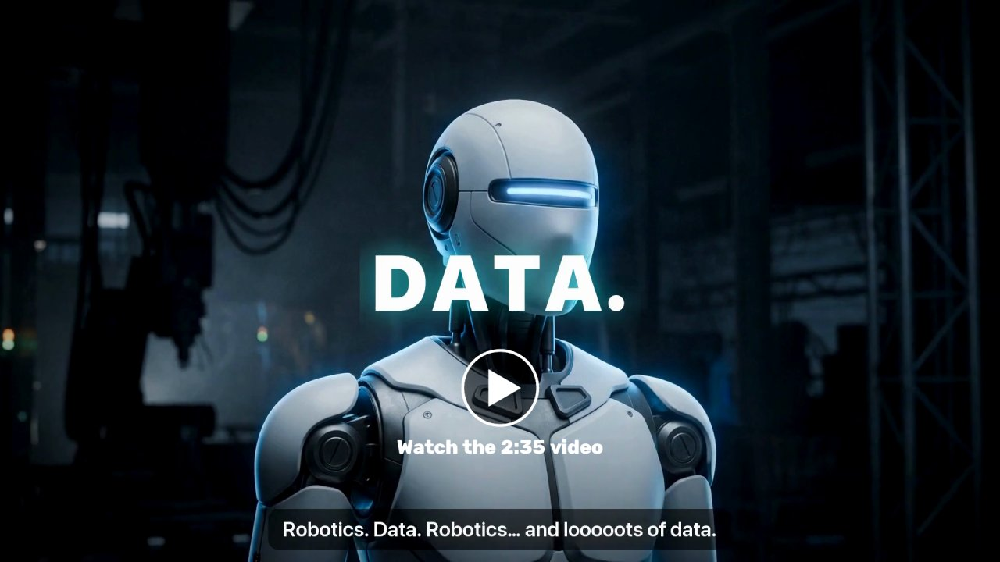</a>
</p>

## DataCash Technique Video

<p align="center">
  <a href="https://youtu.be/o1sGUME0GHw">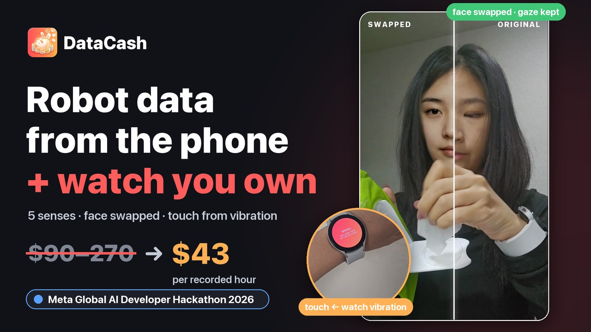</a>
</p>

<p align="center">3 分钟技术演示 · <a href="https://youtu.be/o1sGUME0GHw">English</a> · <a href="https://youtu.be/vClUIqrZjBY">한국어</a></p>

---

# DataCash

**Physical AI 数据项目**<br>
**只用家里已有的手机和手表，收集机器人学习所需的人手数据。**

人们在家用手机和手表录制机器人基础动作任务，并获得报酬。<br>
人形机器人和具身智能公司可以直接购买 **五感数据（视觉·听觉·触觉·动作·生理）** 统一在同一时间轴上的 **LeRobot v3.0** 格式数据。

Meta Global AI Developer Hackathon (Indie Developer)

<p align="center">
  
</p>

---

## How to run

评审期间(11月5–8日)在线演示开放,无需搭建,服务器运行在云端。

| | 链接 |
|---|---|
| **网页**(采购方页面:用自然语言提需求 · 示例 · 目录 · 报价) | https://simhyojin024-datacash.hf.space |
| **运营者后台** | https://simhyojin024-datacash.hf.space/admin — 密码 **`admin`** |
| **人工标注工具** | https://simhyojin024-datacash.hf.space/label — 同一密码 |
| **手机 App**(Android APK) | https://simhyojin024-datacash.hf.space/app.apk |
| **Galaxy Watch App**(Wear OS APK) | https://simhyojin024-datacash.hf.space/watch.apk |

**手机(Galaxy):** 在手机上打开 APK 链接 → 允许浏览器"安装未知应用" → 打开 DataCash → 登记面部 → 选择任务并录制。请让手和物体都在画面里;几乎看不到手的片段会被自动驳回。审核结果、奖励和标注几分钟后回到 App。

**Galaxy Watch:** Wear OS 不能通过浏览器安装 APK,需要用 Wi-Fi adb 安装一次。在手表上:设置 → 关于手表 → 软件信息 → 连续点击 *软件版本* 5 次 → 开发者选项 → 打开 **ADB 调试** 和 **无线调试** → *配对新设备*。然后在同一 Wi-Fi 的电脑上:

```bash
adb pair <watch-ip>:<pairing-port>     # 输入手表上显示的 6 位配对码
adb connect <watch-ip>:<port>
adb install DataCash-Watch.apk
```

在手表上打开 DataCash,它已连接到演示服务器。在手机上开始录制,手表会同时记录手腕动作和触觉。

说明:服务器使用免费 CPU 实例,长时间闲置后首次访问可能需要约一分钟唤醒。上传的片段会保留到服务器重启为止。

---

## 核心技术

### 1. 虚拟人物替换

- **换脸：** 不用模糊，而是把参与者的脸换成用 Muse Image 生成的虚拟人物（LivePortrait + MediaPipe）。<br>
  在同性别、年龄相近的人中挑选候选，先试换 20 帧；如果人脸识别（SFace）把一半以上的帧判为“同一个人”，就换下一位。
- **连续性：** 换出的脸过于相像的帧，不打马赛克，而是减弱表情重新生成。
- **遮盖：** 用 SAM 3.1 遮盖未同意数据采集的人、儿童、屏幕、镜子、相框和文件。
- **删除原始文件：** 正式服务中，处理一结束就立即删除原始视频和音频。<br>
  黑客松演示服务器只关闭了这一调用，以便展示原始与替换后的对比。

#### 换脸的改进过程

| 日期 | 改动 | 结果 |
|---|---|---|
| 10-27 | 用虚拟人物替换代替模糊（LivePortrait，Muse Image 虚拟人物 34 位），每帧做再识别检查 | 保留面部，只换掉身份 · 387 帧中马赛克 3 帧 |
| 10-27 | 速度：把 Mac GPU 上很慢的 Conv3d 拆成 7 次 2D 卷积 + fp16 | 一段录像 636 → 84 秒 |
| 11-01 | 侧脸：同一虚拟人物的 24 张多角度照片（Muse Image 编辑）→ 以最接近当前帧角度的照片为源 | 低头和侧脸变形更少 |
| 11-01 | 虚拟人物的选择：在同性别·年龄段·族群中逐个对候选实际试换几帧，选最不像参与者的人（新增东亚虚拟人物 36 位，$9） | 严格再识别下被认出的帧 3.3 / 11.1 / 17.3 / 30.9% → 2.4 / 6.4 / 1.7 / 5.0% |

<p align="center">
  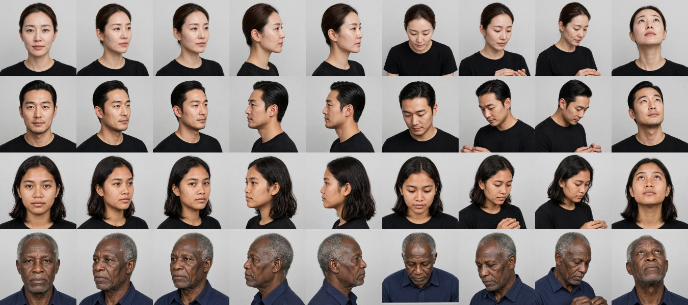<br>
  <sub>每位虚拟人物都有同一个人的多角度照片</sub>
</p>

<p align="center">
  <br>
  <sub>用一张正面照片生成的侧脸 vs 用角度最接近的照片生成的同一画面</sub>
</p>

<p align="center">
  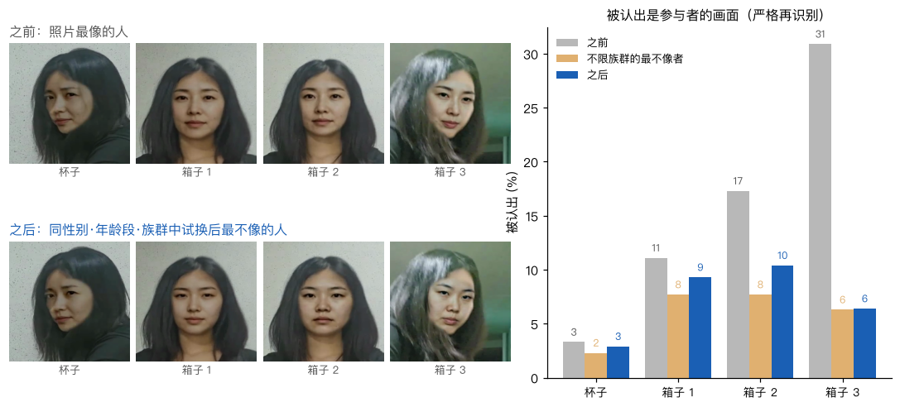<br>
  <sub>虚拟人物选择前后：被认出的帧比例</sub>
</p>

<p align="center">
  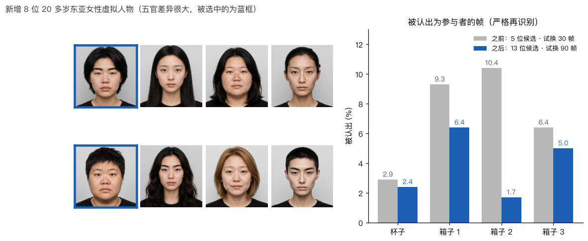<br>
  <sub>增加虚拟人物后被认出帧的前后对比</sub>
</p>

### 2. 不用手套的触觉 —— GripSense 方式

我们把 Goel、Wobbrock、Patel 的 *GripSense*（UIST 2012）移到手腕上，用于触觉测量。<br>
手表短暂振动时，握得越紧，手吸收的振动越多，陀螺仪高频能量下降，而手指支撑产生的 4~12Hz 抖动上升。

<p align="center">
  
</p>

**Galaxy Watch4 实测**（IMU 最高 100Hz，个人校准录像 3 段，用第 1 轮训练 → 第 2 轮评估，再反过来交叉验证）

- **分类：** 随机森林（25 棵树）+ 2 秒平滑，4 级（松开·轻·平常·紧）准确率 **59%**（随机 25%，“紧” 93%）
- **回归：** 在视频检测到手与物体接触的区间，回归森林（50 棵树）把握力估计为 0~100 的连续分数（例如“中 (57)”）<br>
  → 分成 低·中·高 3 档时准确率 **83%**，平均绝对误差（MAE）15 分
- 手表的心率、心跳间隔和皮肤温度通过 Samsung Health Sensor SDK 获取（`docs/samsung_health_sdk.md`）。

<p align="center">
  
</p>

### 3. 五感数据同步

通过手机↔手表时钟往返、18~20kHz 声学信标（高频音）和手表振动脉冲，对齐设备之间的数据。

- 在 37 段真实手机 + 手表录像中，**24 段由声学信标**对齐（配对残差 0.1~1.9ms）。
- 其余使用经服务器中转的时钟对齐；该时钟比信标偏 24.7ms（±3.5），因此按每个设备组合测量并扣除这一偏差。
- 结果：手表 ↔ 视频时间误差 **24.7 → 3.7ms**（销售标准 10ms）

<p align="center">
  
</p>

### 4. 提高 Spark 1.3 标注准确率

为了提高各区间、各动作的标注准确率：

1. 把视频切成 20 秒片段、0.5 倍速，**标注 5 次后比较验证**（合并结果选出一个顺序）
2. 用开放权重的 **Spark Open 816B 再次验证**（重新选出动作切换的边界帧）
3. **人工标注验证**
4. **用 Spark 按任务自动生成标签**

以 EPIC-KITCHENS-100 未见过的 8 段（271 个人工步骤）为基准，标注准确率 **36% → 54%（+18%p）**，边界误差 **430 → 182ms**。

> 也考虑过用 Muse Wonderful 再验证，但它在韩国不可用，所以使用了开放权重模型。

### 5. 用 Glimmer 节省 API

为了不必每次都把标注交给 Muse Spark API，我们用自己的数据训练了开放权重的 Muse Glimmer 30B（Fireworks LoRA）。<br>
Spark 生成标签草稿，人工确认和修改后的步骤作为真值，供 Glimmer 学习。

- 训练前 **41.8%** → 用确认后的真值训练 **54.1%** → 加入按任务动作顺序的解码 **64.1%**
- 今后随着数据积累，Glimmer 可以接手判断，减少 Spark API 调用，提高业务利润率。

### 6. 降低 SAM 物体判断成本

- 无法使用的录像（太短、看不到手、太暗）在**调用 API 之前**就在这台 Mac 上退回。
- 先用这台 Mac 的物体检测扫描，只把需要的判断交给 SAM。<br>
  （单人录制不查询“人”，屏幕仅在出现时查询，静止物体每秒 1 帧）
- 4 段真实录像：SAM 费用 **$2.92 → $0.27（−91%）**，每小时视频约 $5~7（售价 ₩60,000/小时（约 $43））
- 用 Numba 重写 SAM 掩码解码，处理时间 **593 秒 → 8 秒**

---

## LeRobot 销售数据（LeRobot v3.0）

<p align="center">
  
</p>

| 项目 | 内容 |
|---|---|
| 视频 | `observation.images.ego`（遮盖 + 换脸后的视频） |
| 姿态 | `observation.hands` · `observation.body` · `observation.face` |
| 动作 | `observation.imu.phone` · `observation.imu.wrist` |
| 声音 | `observation.audio` |
| 触觉 | **`observation.touch`**（接触、握力 低·中·高 + 0~100 分）· `observation.touch.vibration` |
| 生理 | **`observation.physio`**（心率、皮肤温度，仅限生物信息同意者） |
| 物体·标签 | `observation.objects` · `annotation.step` · `annotation.primitive`（reach·grasp·…·release） |
| 同步 | `sync.error_ms` + 质量证书 |

可用真实的 `lerobot` 0.6.1 读取（`scripts/validate_lerobot.py`）。

传感器按组合选购（每小时，`datacash/pricing.py`）。

| 视频（必选） | 姿态 | 声音 | 手腕 IMU | 触觉 | 生理 |
|---|---|---|---|---|---|
| ₩35,000 | ₩20,000 | ₩5,000 | ₩15,000 | ₩25,000 | ₩50,000 |

---

## 架构

**整体流程** — 企业用一句话提出需求，任务随即开放；参与者用手机和手表录制上传，服务器处理后交付数据并发放报酬。

<p align="center">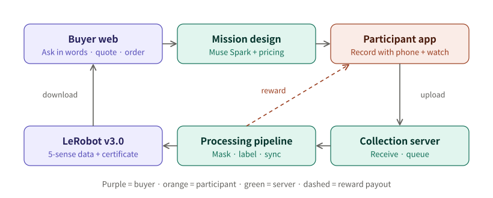</p>

**一段录像的处理顺序**（`datacash/jobs.py`）— 先做不花钱的步骤，无法使用的录像在调用 Meta 模型之前就被退回。

<p align="center">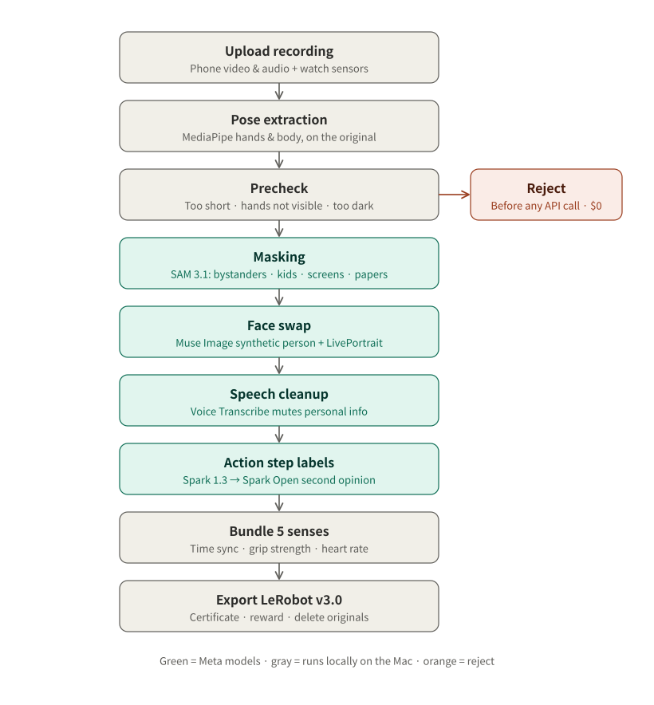</p>

**技术栈与部署** — 目前不使用 Docker 或云：一台 Mac 负责服务器和全部处理，手机和手表应用在同一 Wi-Fi 下通过 mDNS 找到服务器并直接上传。

<p align="center">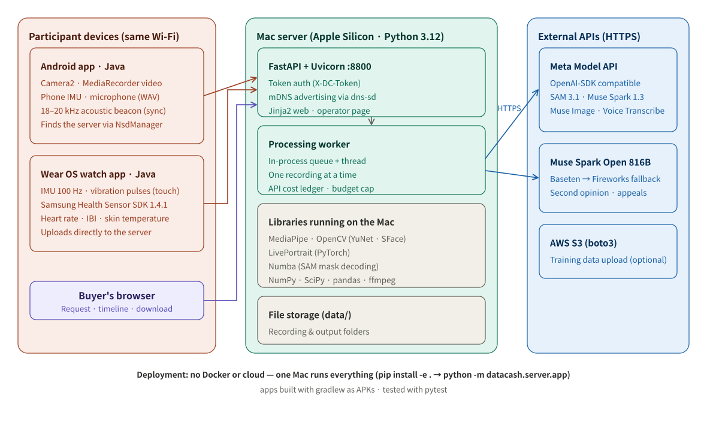</p>

## Run locally(在自己的电脑上 — 包括换脸)

换脸需要 GPU,免费云服务器没有 GPU。想完整体验包括虚拟人物换脸在内的全部流程,请在自己的电脑上启动服务器:Apple Silicon Mac 或带 NVIDIA GPU 的 PC 都可以。在 MacBook 上,一段 30 秒的片段大约需要 6 分钟。需要 Python 3.12、git 和 **Meta Model API 密钥**。密钥用于 SAM 3.1 遮挡和 Muse Spark 标注;没有它,录像无法生成可出售的数据。`FIREWORKS_API_KEY` 为可选,填上后会加上 Spark Open 二次校验。

```bash
git clone https://github.com/hyojin-shj/DataCash.git && cd DataCash
python3.12 -m venv .venv && .venv/bin/pip install -e . torch pyyaml rich huggingface_hub
.venv/bin/python scripts/fetch_models.py      # 模型文件 + LivePortrait(约 700MB)
echo "MODEL_API_KEY=你的-Meta-Model-API-密钥" > .env
DATACASH_TOKEN=自定义令牌 .venv/bin/python -m datacash.server.app --port 8800
```

- **网页 / 运营者:** http://localhost:8800 、 http://localhost:8800/admin(密码 = 自定义令牌)
- **手机:** 连到同一 Wi-Fi → DataCash → *连接智能设备* → *数据服务器*。输入 `http://<电脑IP>:8800` 和令牌 → *保存并检查连接*。Mac 上用 `ipconfig getifaddr en0` 查看 IP。
- **手表:** 按 How to run 中的方法用 adb 安装后,把它指向你的服务器:

```bash
adb shell am start -n com.datacash.wear/.WatchActivity --es server http://<电脑IP>:8800 --es token 自定义令牌
```

## 目录

| 目录 | 作用 |
|---|---|
| `app/` | 安卓 App（同意、任务、人脸确认、录制、标记失误、问题、上传、报酬、申诉）+ 手表 App |
| `web/` | 购买企业网页（自然语言需求、五感时间轴、报价、订单、下载）、运营后台 |
| `datacash/privacy` | SAM 遮盖 · 换脸 · 语音隐私 · 预扫描 |
| `datacash/sync` · `touch` · `labels` | 五感同步 · 触觉 · 手和身体姿态 |
| `datacash/understand` | Muse Spark 理解 · Spark Open 第二次验证 · 传感器验证 |
| `datacash/export` · `jobs.py` | LeRobot 导出 · 证书 · 处理流程 |
| `datacash/server` | 采集服务器 + 购买企业 API |

## Meta 模型的使用

| 模型 | 用途 |
|---|---|
| **SAM 3.1** | 遮盖未同意的人、儿童、屏幕、镜子、相框和文件，识别被操作的物体和动作 |
| **Muse Spark 1.3** | 遮盖后的视频 → 步骤、指令、使用的手、物体、失误标注<br>企业的自然语言需求 → 任务设计 → 按任务生成标签 |
| **Muse Image** | 生成 70 位不存在的虚拟人物（用于换脸），每人 24 张同一个人的多角度照片 |
| **Muse Voice Transcribe** | 把录音中能听到个人信息的区间静音 |
| **Muse Spark Open** | 对录像做第二次验证、复审申诉的“更高级模型”。<br>两个模型看法不同的步骤会被改正；看法一致且经传感器验证的步骤成为正确示例，加进下一段录像对 Spark 1.3 的提问。 |
| **Muse Glimmer 30B** | 用 Spark 1.3 草稿和人工验证过的标签学习视频识别。<br>数据越多性能越好，可以降低对 API 的依赖。 |

## 实测性能

| 指标 | 之前 → 现在 | 测量于 |
|---|---|---|
| 步骤标签逐帧准确率（Muse Spark 1.3） | **35.6% → 54.3%** | EPIC-KITCHENS-100 新 8 段，271 个人工步骤 |
| 步骤边界误差（中位数） | **430 → 182ms** | 同上 |
| Muse Glimmer 30B 步骤准确率（LoRA，Fireworks） | **41.8% → 54.1% → 64.1%**<br>（v80 用人工真值训练 · v82 + 按任务的顺序解码，范围 60.7–67.2% · 用 Spark 标签训练的 v79 为 32.8%） | 未用于训练的 8 段录像中 122 个人工步骤 |
| 手表 ↔ 视频时间误差 | **24.7 → 3.7ms**（标准 10ms） | 手机 + 手表录像 37 段 |
| 每段录像换脸时间 | **636 → 84 秒**（7.5 倍） | `docs/privacy_eval.md` |
| SAM 3.1 费用，4 段录像 | **$2.92 → $0.27**（−91%） | 4 段真实录像 |
| 握力 低·中·高 | **83%**（随机 33%） | 校准录像 3 段，Galaxy Watch4 |

<p align="center">
  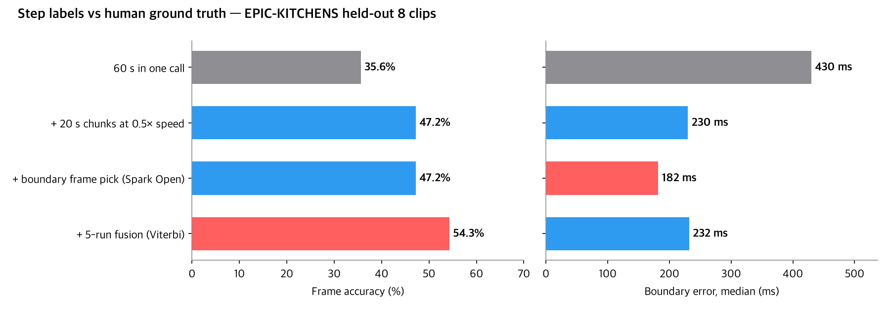<br><br>
  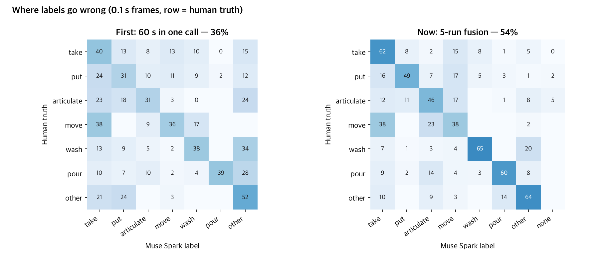<br><br>
  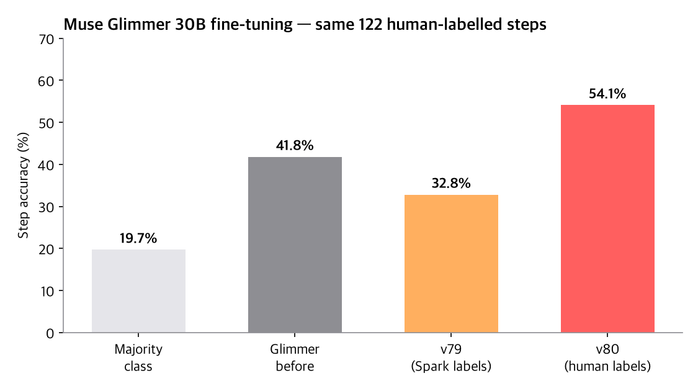<br><br>
  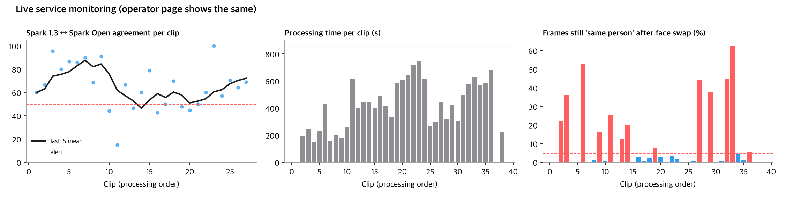
</p>

**服务监控**（与运营后台相同的数值，`datacash/perf.py`）— 超过标准就告警，该录像进入复查。

- 每段录像的 Spark 1.3 ↔ Spark Open 一致率及最近 5 段平均 — 低于 50% 告警
- 每段录像的处理时间 — 超过中位数 2 倍告警
- 换脸后仍被认作同一个人的帧（SFace 0.363）— 超过 5% 告警

---

## 黑客松之前 / 之中

| | 内容 |
|---|---|
| 黑客松之前（10-26 之前） | 只有计划文档和品牌图片，没有代码 |
| 黑客松之中（韩国时间 10-27 01:00 起） | 本仓库中的全部代码 · App · 网页 · Muse Image 虚拟人物 · 文档 |

## 许可与来源

MediaPipe (Apache 2.0) · OpenCV YuNet·SFace (Apache 2.0) · LivePortrait (MIT) · LeRobot (Apache 2.0) · Numba (BSD)<br>
测试视频来自 Wikimedia Commons（仅 CC BY·CC BY-SA·公有领域，来源见 `docs/privacy_eval.md`）<br>
Samsung Health Sensor SDK
